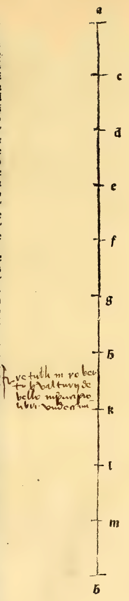

:layout: book

.. _architectura-cap_04-de:

CAPITEL IV (Deutsch — Winterberg 1889)
======================================

.. rubric:: Es folgt von den runden Säulen mit ihren Basen und Capi- tellen und Pilastern oder Stilobaten.

.. container:: track-nav

   :ref:`English <architectura-cap_04-en>` · :ref:`Italiano (1509) <architectura-cap_04-it>` · **Deutsch (1889)** · :ref:`Notes <architectura-cap_04-notes>` | :ref:`Conspectus <architectura-index>` · :ref:`← Prev <architectura-cap_03-de>` · :ref:`Next → <architectura-cap_05-de>`

.. folio:: 0069–0070 (f. 27r–f. 27v)
   :initial: 0069.c1.png

Da ich euch in Kurzem das Nöthige über die runden Säulen angeben will, so werde ich diesen Abschnitt in zwei Haupttheile zerlegen, im ersten werde ich von der Säule und ihrer Grundfläche und Capitell, im zweiten von ihren Stilobaten oder auch Pilaster oder Basament, nach Einigen, reden. Ich sage wie oben, es müsse sich jedes Glied jedes Gebäudes zu dem ganzen besagten Gebäude proportioniren, wie jedes Glied des Menschen zum ganzen Menschen gebildet worden, \as un die Natur durch Beispiel vor Augen gestellt hat.

Und damit auch die Fremdwörter, wie es vorher von :person:`Vitruv <vitruvius>` angegeben, im Geiste keine Dunkelheit erzeugen, der sie manchmal Jonische, manchmal Dorische und Korinthische nennt, so wisset, dass diese Namen ihnen von den Alten nach dem Vaterland gegeben worden, wo sie zuerst vorgefunden; Jonisch bei den Joniern, korinthisch bei den Korinthern, dorisch gleicherweise. Und mitunter wird das Wort vom ersten Erfinder abgeleitet. Nun mögen euch dieselben keinen Widerwillen veranlassen. Denn :person:`Vitruv <vitruvius>` erklärt es vollkommen, daher kümmere ich mich hier nicht, mich allzusehr zu verbreiten.

Ihr müsst beachten, dass wie wir in unserer christlichen Religion verschiedene Heilige beiderlei Geschlechts haben, und jedem darin seine Zeichen und Instrumente geben und beilegen, je nachdem sie für den Glauben gekämpft, wie dem heiligen Georg die Waffen, Lanze, Kürass, Helm, Schwert und Pferd mit aller Armatur, ebenso dem heiligen Moritz und heiligen Eustachius und den Maccabäern u, s. w. und man der heiligen Katharina das Rad, weil sie mit diesem für den Glauben gekrönt, der heiligen Barbara den Thurm gibt, worin sie eingekerkert, und so über alle Heiligen Männern und Frauen discutirend, die Kirche zu ihrer Erinnerung Aehnliches, was in unsern Augen zur Entflammung des heiligen Glaubens thun zu dürfen erlaubt, indem sie sich durchaus nicht um Tyrannen kümmerten, da die heiligen Götter die Schläge der Henker nicht gefürchtet, genau so, jene ihren irrenden Religionsgebräuchen gemäss ihren Idolen und Göttern bald auf die eine, bald auf die andere Weise irgend welche Ornamente machten, entsprechend der Form ihrer Wirkung, in Trophäen, Tempeln und Säulen, indem sie dieselben nach ihren Namen oder Vaterlande nannten und tauften, wo sie zuerst Ursprung genommen. (Wie in den Geschichten der Römer gesagt wird, dass Fabius von den Bohnen so genannt, und andere sagen, dass die Bohnen von Fabius benannt seien.

Und ebenso liest man von Appius, dass er, weil sie (von ihm) gegessen wurden, benannt worden, nach den Aepfeln, und andere wollen, dass „Apie", d. h. besagte Aepfel, nach Appius benannt seien, der sie zuerst in jene Gegenden brachte u. s. w., und ebenso geschieht es bei eben diesen und sie machten eins von diesen Werken schöner als das andere, je nach der Frömmigkeit dieses oder dieser, worin emsig gearbeitet sein wird, wie für Herkules, Mars, Jupiter u. s. w., für Diana, Minerva, Ceres u. s. w., wie von allen vollständig unser :person:`Vitruv <vitruvius>` erwähnt.) Von da zu unserem Zweck zurückkehrend, so pflegten die Alten die Höhe der runden Säule mit der ganzen Höhe, die sie mit ihrem Capitell zu machen beabsichtigten/) in acht gleiche Theile zu zerlegen.

Und sodann theilten sie dieselbe besagte Höhe nochmals in zehn gleiche Theile. Und den einen derselben nahmen sie von dem Achtel fort, so dass dabei genau der vierzigste Theil der ganzen besagten Höhe übrig blieb, d. h. einer von vierzig Theilen, und diesen behielten sie als Abacus seines Kapitells, wie ihr in der zu Anfang dieses ganzen Briefs aufgestellten Figur besagte Abacushöhe In oder mo angegeben habt, die mitunter von Modernen Gesimse genannt wird.

Und von der Höhe des ganzen Zehntels machten sie die Glocke oder Trommel, oder wir wollen sagen das Rankenwerk des Capitells, was dasselbe besagt, bis zur Kehle oder Verengung des obern Theils der Säule, wie lg oder mh, welches Alles mit seinem Abacus bis zum höchsten Theil besagter Glocke Capitell genannt wird. Dort sagt man Volute, welches in vier Ecken des genannten Capitells ausläuft, wie ihr die Spitze / und die Spitze m seht. Von einer Ecke oder Winkel des Abacus oder Gesimsplatte bis zum andern wird Tetrant genannt, nämlich jener Raum, der zwischen einer und der andern Ecke liegt, nämlich no, so dass in jedem Abacus vier Tetranten sind.

In dessen Mitte pflegt man eine grosse Blume oder Rose oder anderes Blatt zum Schmuck zu machen, d. h. eins per Tetrant, und es wird Auge des Kapitells genannt. Diese Tetranten werden auf folgende Ait gebildet, nämlich: man nimmt den Durchmesser der Verjüngung unterhalb, d. h. von jener Kehle, die sich unterhalb der Basis befindet, und denselben verdopple man, und mache ihn zur :term:`Diagonale <diagonale>` eines Quadrats,, welches genau im Kreise liegt. Und dieses Quadrat ist genau der Abacus besagten Capitells. Und jener Tetrant wird gegen das Centrum besagten Vierecks hin hohl oder abgerundet gemacht, indem man ihn um ein Neuntel der Seite des besagten Vierecks krümmt, d. h. gekrümmt bis zur Lage seines Auges in der Front.

Und dieser wird bald mehr, bald weniger verziert, je nach dem, der die Ausgabe macht und anordnet, mit einem oder zwei Abacus über einander gestellt, wie es ihm besser zusagt, nach Belieben, indem man die vorgeschriebenen Proportionen ihrer Abstufungen beibehalt, die bei jedem Entwürfe stets als beobachtet vorausgesetzt werden, indem man sie verhältnissmässig herabsetzt, d. h. auf kleineres Mass reducirt, und sie vergrössert, d. h. zu grösseren anwachsen lässt, wie bei den Entwürfen zu allen Modellen, die zuerst gemacht werden, welchen gemäss der Architekt nothwendigerweise das ganze darin Enthaltene auf den wirklichen Bau anzuwenden verstehen muss u. s. w. Und dies genüge, soweit es sich auf sein Capitell bezieht, welches der korinthischen zugehört.

Marginal Woodcut Diagrams (Paganini 1509)
-----------------------------------------

   Folio 0069 Diagram 1
