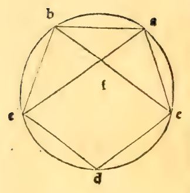

:layout: book

.. _compendio-cap_17-en:

CHAPTER XVII (English)
======================

.. rubric:: On the Eighth Effect, the Converse of the Preceding

.. container:: track-nav

   **English** · :ref:`Italiano (1509) <compendio-cap_17-it>` · :ref:`Deutsch (1889) <compendio-cap_17-de>` · :ref:`Notes <compendio-cap_17-notes>` | :ref:`Conspectus <compendio-index>` · :ref:`← Prev <compendio-cap_16-en>` · :ref:`Next → <compendio-cap_18-en>`

.. folio:: 0028 (f. 6v)
   :initial: 0028.c1.png

.. enunciation::

   If a line be divided according to the proportion having a mean and two extremes, then for that circle in which the **greater part** is the **side of the inscribed hexagon**, the **lesser part** will always be the **side of the regular decagon** inscribed in the very same circle (:just:`XIII.9`).

.. assertion:: Numerical Demonstration and Ptolemaic Application

   For example, if the divided line is $10$, its **greater part**, which is $\sqrt{125} - 5$, will always be the side of the equilateral hexagon of a circle whose diameter is double $\sqrt{125} - 5$, namely $\sqrt{500} - 10$ (:just:`IV.15`). I say that in that very same circle, the **lesser part**, $15 - \sqrt{125}$, will be the side of the equilateral decagon inscribed therein.

.. qed::

   Of this converse :person:`**Ptolemy** <ptolemy>` makes great use in the ninth [tenth] chapter of the First Book (*prima dictione*) of his :cite:`*Almagest* <ptolemy:almagest:I.9>` to demonstrate the lengths of the chords of circular arcs (*la quantità dele corde degli archi del cerchio*); and it is similarly demonstrated openly in the commentary upon the aforesaid ninth proposition of the Thirteenth Book (:just:`XIII.9`) geometrically.

Marginal Woodcut Diagrams (Paganini 1509)
-----------------------------------------

   Folio 0028 Diagram 1
