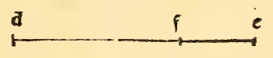

:layout: book

.. _compendio-cap_21-de:

CAPITEL XXI (Deutsch — Winterberg 1889)
=======================================

.. rubric:: Von ihrer zwölften fast unbegreiflichen Wirkung.

.. container:: track-nav

   :ref:`English <compendio-cap_21-en>` · :ref:`Italiano (1509) <compendio-cap_21-it>` · **Deutsch (1889)** · :ref:`Notes <compendio-cap_21-notes>` | :ref:`Conspectus <compendio-index>` · :ref:`← Prev <compendio-cap_20-de>` · :ref:`Next → <compendio-cap_22-de>`

.. folio:: 0029–0030 (f. 7r–f. 7v)
   :initial: 0029.c1.png

Wenn eine Grösse nach unserer genannten Proportion getheilt wird, so verhält sich die Wurzel aus der Summe aus dem Quadrat der ganzen Grosse und dem Quadrat ihres grössern Abschnitts zur Wurzel der Summe aus dem Quadrat genannter Grösse und dem Quadrate ihres kleinern Abschnitts, wie die Seite des Kubus zur Seite des Dreiecks des zwanzigflächigen Körpers. Es sei beispielsweise 10 die nach der Proportion, welche einen mittleren und zwei äussere Abschnitte hat, getheilte Grösse, so dass der eine Theil, nämlich der grössere, wie mehrfach gesagt worden, |Xi25 — 5 und der kleinere i5 — y 12b ist.

Nun quadrire man die genannte angegebene Grösse 10, d. h. multiplicire sie mit sich selbst, so ergibt das 100, und man quadrire ferner ihren grössern Abschnitt, nämlich √1 25 — 5, -welcher mit sich selbst multiplicirt i5o — \ ii5 00 ergeben wird, und quadrire noch den kleinern Abschnitt, d, h. i5— √125, welcher mit sich multiplicirt 35o — |/ ii25oo macht. Nun füge man zu dem Quadrat des grössern Abschnitts, nämlich zu i5o — j/ i25oo das Quadrat der ganzen Grösse nämlich 10, welches 100 ist, so ergibt sich 25o|Xi25oo.

Dasselbe Quadrat der genannten Grösse, d. h, 100, füge man zu dem Quadrate des kleinern Abschnitts, der, wie wir gefunden, 35o — ]/ ii25oo, zu dem 100 addirt, sich 450 — lXii25oo ergeben wird. Jetzt behaupteich, dass das Verhältniss der Wurzel der einen Summe, d. h, 25o — |Xi25oo die aus dem Quadrat der genannten Grösse und dem des grössern Abschnitts gebildet worden, zu der Wurzel der andern Summe, welche aus dem Quadrat der genannten Grösse und dem ihres kleinern Abschnittes, d. h. 450 — ]/ii25oo gebildet ist, genau dasselbe sei, wie das Verhältniss der Seite des Kubus zur Dreiecksseite des zwanzigflächigen Körpers; wenn beide Körper von ein und derselben Kugel umschrieben oder umgeben sind.

Diese Wurzeln der Summen werden als Potenzlinien der ge nannten Summen bezeichnet, d. h, j/o — ■|/"i25oo bedeutet eine Grösse, deren Potenz oder Quadrat genau die genannte Summe ist. Und ebenso bedeutet \/ 4.5o — ]/ Jiböö eine Grösse, deren Potenz, oder wir wollen sagen Quadrat, genau 45o — y 1 1 25oo ist, welche Wurzeln mit anderm Namen von den Praktikern universale Wurzeln oder auch verbundene Wurzeln genannt werden, wie auch in unserm vorerwähnten Werke im dritten Tractat seiner achten Unterscheidung am Anfang von Blatt 1 20 des genannten Bandes erhellt.

Die Untersuchung dieser Grössen ist höchst subtil und sie beziehen sich auf speculative Praxis, wie es in eingehender Art in dem genannten Bande sich offenbart. — Und diese alle, erhabener Fürst, ist es nicht möglich, mit niederem Merkmalen anzugeben. Und diese ganze speculative Wirkung wird mittelst der neunten des vierzehnten geometrisch nebst einigen andern an jener Stelle angeführten von Gampanus bewiesen.

Marginal Woodcut Diagrams (Paganini 1509)
-----------------------------------------

.. figure:: 0029.g1.png
   :align: center

   Folio 0029 Diagram 1

   Folio 0029 Diagram 2
