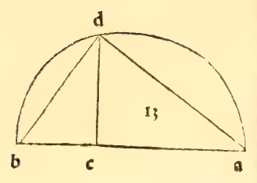

:layout: book

.. _compendio-cap_25-de:

CAPITEL XXV (Deutsch — Winterberg 1889)
=======================================

.. rubric:: Warum es nicht mehr als fünf regelmässige Körper geben kann.

.. container:: track-nav

   :ref:`English <compendio-cap_25-en>` · :ref:`Italiano (1509) <compendio-cap_25-it>` · **Deutsch (1889)** · :ref:`Notes <compendio-cap_25-notes>` | :ref:`Conspectus <compendio-index>` · :ref:`← Prev <compendio-cap_24-de>` · :ref:`Next → <compendio-cap_26-de>`

.. folio:: 0031–0032 (f. 8r–f. 8v)
   :initial: 0031.c1.png

Es ziemt sich jetzt zu zeigen, warum nicht mehr als fünf Körper in der Natur existiren können derart, nämlich dass alle ihre Grenzflächen unter sich gleich und von gleichen körperlichen und ebenen Winkeln und ebenso von gleichen Seiten, welche Sache daraus erhellt, weil zur Herstellung eines körperlichen Winkels (scil. Ecke) der Zusammenstoss von wenigstens drei Flächenwinkeln nothwendig ist, weil sich mit zwei Flächenwinkeln allein ein körperlicher Winkel nicht begrenzen lasst.

Weil nun drei Winkel jedes gleichseitigen Sechsecks gleich vier rechten Winkeln sind, und ferner vom Heptagon, d. h. einer siebenseitigen Figur und allgemein von jeder gleichseitigen und auch gleichwinkligen Figur von mehr Seiten ihre drei Winkel immer grösser als vier Rechte sind, wie es aus der zweiunddreissigsten des ersten evident erhellt, und jeder körperliche Winkel kleiner als vier Rechte ist, wie die einundzwanzigste des elften bezeugt, deshalb ist es unmöglich, dass drei Winkel des Hexagons und Heptagons, und allgemein irgendwelcher gleichseitigen und gleichwinkligen Figur von mehr Seiten einen körperlichen Winkel bilden.

Und hierdurch ist offenbar, dass keine körperliche gleichseitige und gleichwinklige Figur aus Oberflächen von sechs oder aus mehr Seiten sich bilden könne. Denn wenn die drei Winkel des gleichseitigen und gleichwinkligen Sechsecks grösser sind, als ein körperlicher Winkel, so folgt, dass vier und mehr weit stärker den genannten körperlichen Winkel übertreffen werden. Von den drei Winkeln des gleichseitigen und gleichwinkligen Pentagons aber ist klar, dass sie kleiner als vier rechte Winkel sind; und vier derselben sind grösser als vier Rechte. Daher kann man aus den drei Winkeln eines gleichseitigen und gleichwinkligen Fünfecks den körperlichen Winkel bilden, dagegen aus vier seiner Winkel oder mehr ist es nicht möglich einen körperlichen Winkel zu bilden.

Und deswegen wird nur ein Körper aus gleichseitigen und gleichwinkligen Pentagonen gebildet, der :term:`Dodekaeder <dodecahedron>`, mit anderm Namen Körper von zwölf Pentagonen, von den Philosophen genannt wird. Bei demselben bilden und enthalten die Winkel der Fünfecke je zu drei alle körperlichen Winkel des genannten Körpers. Dasselbe Raisonnement wie hinsichtlich der Pentagone gesagt,findet statt bezüglich der vierseitigen Figuren von gleichen Seiten und Winkeln. Denn jede vierseitige P'igur, wenn sie gleichseitig und gleichwinklig sein soll, wird der Definition nach quadratisch sein, da alle ihre Winkel rechte sein werden, wie sich aus der zweiunddreissigsten des ersten zeigt.

Daher ist es möglich, aus drei Winkeln einer solchen ebenen Figur einen körperlichen Winkel zu bilden, aber aus vier derselben oder mehreren ist es unmöglich. Daher kann aus solchen Flächenfiguren, sofern sie vierseitig gleichseitig und gleichwinklig sind, ein fester Körper gebildet werden, den wir Kubus nennen, der ein Körper ist, welcher von sechs quadratischen Flächen umfasst wird und zwölf Kanten und acht Ecken hat. Und bei gleichseitigen Dreiecken sind sechs Winkel gleich vier Rechten nach der genannten zweiunddreissigsten des ersten. Daher sind weniger als sechs kleiner als vier Rechte, und mehr als sechs sind grösser als vier Rechte.

Daher kann man aus sechs Winkeln oder mehr von ebensolchen Dreiecken keinen körperlichen Winkel bilden, aber aus drei und vier und aus fünf kann man ihn bilden. Und sofern drei Winkel des gleichseitigen Dreiecks einen körperlichen Winkel enthalten, deshalb wird aus gleichseitigen Dreiecken der von vier gleichseitigen Dreiecksflächen begrenzte Körper gebildet, :term:`Tetraeder <tetrahedron>` genannt. Und wenn ferner vier solche Dreiecke zusammenlaufen, entsteht der achtflächige Körper, :term:`Oktaeder <octahedron>` genannt, und wenn fünf gleichseitige Dreiecke einen körperlichen Winkel enthalten, dann bildet sich der :term:`Ikosaeder <icosahedron>` genannte Körper zu zwanzig gleichseitigen und gleichwinkligen Dreiecksflächen.

Es ist daher nach dem was wir gesagt, völlig klar, warum der regelmässigen Körper soviele und solche und nicht mehr existiren etc.

Marginal Woodcut Diagrams (Paganini 1509)
-----------------------------------------

   Folio 0032 Diagram 1

.. figure:: 0032.g2.png
   :align: center

   Folio 0032 Diagram 2

.. figure:: 0032.g3.png
   :align: center

   Folio 0032 Diagram 3
