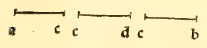

:layout: book

.. _compendio-cap_26-it:

CAPITOLO XXVI (Italiano — 1509)
===============================

.. rubric:: De fabrica seu formatione eorum 5 regularium et deproportione cujusque ad diametruni spere et primo de tetracedron).

.. container:: track-nav

   :ref:`English <compendio-cap_26-en>` · **Italiano (1509)** · :ref:`Deutsch (1889) <compendio-cap_26-de>` · :ref:`Notes <compendio-cap_26-notes>` | :ref:`Conspectus <compendio-index>` · :ref:`← Prev <compendio-cap_25-it>` · :ref:`Next → <compendio-cap_27-it>`

.. folio:: 0032 (f. 8v)
   :initial: 0032.c1.png

Veduto e inteso che sienno li corpi regulari e quanti aponto seque ora adire commo se formino acio sienno aponto circondati da vna spera e ancora che proportione e denotatione de loro overo suoi lati al dyametro dela spera che aponto li circundasse. mediante laquale se vene in notitia de lor tutti. E pero prima diremo del tetracedron cioè del 4 basi trianguläre equilatero e poi de cadauno deli altri successiuamente per ordine sequendo se dira.

Dico adonca dicto corpo douerse cosi formare, cioè prima

se prenda el dyametro dela spera in laquale noi intendiamo collocarlo qual poniamo che sia la linea ab. E questa se diuida nel ponto e. in modo che la parte ac. sia dopia ala parte bc, E faciase sopra lei el semicirculo adb. e tirise la linea ed perpendicular sopra la linea ab. e tirinse le linee bd. e da. Dapoi se facia el cerchio fgh. sopra el centro e. del quale el semidiametro sia equale ala linea ed. Nel qual cerchio poi se facia vn triangulo equilatero: secondo che insegna la seconda del 4. E questo triangulo sia fgh. E dal centro ali suoi angoli se tirino le linee ef . eg . eh. Poscia sopra el centro: e. se leni la' linea ek. perpendiculare ala superficie del cerchio fgh. commo insegna la 12 del i i. E questa perpendiculare ponghise equale ala linea ac. E dal ponto k se lascino le ypotomisse kf . kg . kh. Le quali cose cosi aponto obseruate dico esser finita la pyraraide de 4 basi triangulari de lati equali. E

1. al.

questa aponto sira circunscripta dala spera di quel tal dyametro ab. E dico per la proportione fral dyametro dela spera el lato dela fabricata pyramide el quadrato de dicto dyametro essere sex quialtera al quadrato del lato de dieta pyramide. cioè chel quadrato del dyametro contiene el quadrato del lato dela pyramide vnauolta e mezza: cioè commo 3a2 eoa 4. E voi dire che sei quadrato de dicto dyametro fosse 6 el quadrato del lato dela pyramide seria 4. E cosi se troua prouato in geometria.

Marginal Woodcut Diagrams (Paganini 1509)
-----------------------------------------

.. figure:: 0032.g1.png
   :align: center

   Folio 0032 Diagram 1

   Folio 0032 Diagram 2

.. figure:: 0032.g3.png
   :align: center

   Folio 0032 Diagram 3
