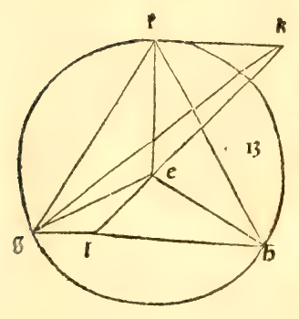
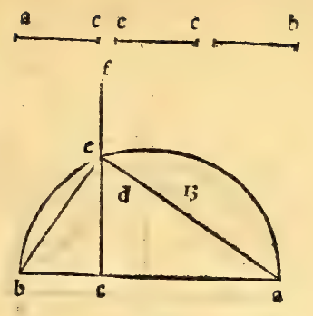

:layout: book

.. _compendio-cap_27-it:

CAPITOLO XXVII (Italiano — 1509)
================================

.. rubric:: Dela fabrica del cubo e sua proportione ala spera.

.. container:: track-nav

   :ref:`English <compendio-cap_27-en>` · **Italiano (1509)** · :ref:`Deutsch (1889) <compendio-cap_27-de>` · :ref:`Notes <compendio-cap_27-notes>` | :ref:`Conspectus <compendio-index>` · :ref:`← Prev <compendio-cap_26-it>` · :ref:`Next → <compendio-cap_28-it>`

.. folio:: 0032–0033 (f. 8v–f. 9r)
   :initial: 0032.c1.png

Sequita a demostrare commo se formi el cubo e qual sia la proportione fral lato suo elo dyametro dela spera che aponto lo circundasse, per la qual

cosa dico dicto cubo do- - ^ . ^ ^ ^^£ b

uerse cosi formare cioè. Prima se prenda el diametro dela spera. Nela quale intendiamo aponto collocarlo. E questo sia la linea ab. sopra la quale faro el semicirculo adb. Epoi diuidaro el diametro nel poncto e. si commo feci in la formatione dela piramide precedente. Cioè

che la parte ac. sia dopia ala parte bc. Etirise la linea ed. perpendiculare ala hnea ab. Etirinse ancora le linee db. e da. Dapoi se facia vnquadrato del quale tutti li lati sienno equali ala linea bd. E sia quel tal quadrato efgh. E sopra li suoi 4 anguli seleuino 4 linee perpendiculari ala superficie del dicto quadrato commo insegna la duodecima del vndecimo. Equesti tali perpendiculari ognuna sia posta ancora equale ala linea bd. e sienno le ditte 4 perpendiculari ek . ti , gm . hn. E siranno queste 4 perpendiculari ognuna equidistante alaltra fraloro per la sexta del dicto vndecimo. E li anguli da quelle e dali lati del quadrato contenuti sonno recti per la diffinitione de la linea perpendiculare ala superficie. Dapoi congiunghinse le extremita di queste perpendiculari tirando le linee kl . Im . mn. nk. Le quali cose con diligentia a ponto seruate sira finito el cubo che circauamo de formare, da 6 superficie quadrate contenuto

che seproua per la 34. 7 del primo le 4 superficie

che lo circundano e sonno quelle dele quali li lati oppositi sonno le 4 perpendiculari sonno tutte quadrate. De la basa che la sia quadrata questo se manifesta per la nostra propositione. E ancora che la suprema superficie sia ancor lei quadrata cioè klmn. se demostra ancora per la dieta 34. del primo e per la decima de lo vndecimo. E cosi ancora per la quarta del ditto vndecimo se manifesta tutti li lati de dicto cubo stare orthogonalmente sopra le sue doi superficie opposite. E questo talei) aponto dala spera del proposto diametro sira circumscripto. Onde sempre dicto diametro sira triplo in potentia allato del ditto cubo cioè chel quadrato de ditto diametro sira tre tanto del quadrato dellato del cubo. Commo sei diametro fosse R. 300 ellato del cubo conueria essere io aponto. Lacui notitia a molti casi necessarii fia oportuna. etc.

£-

/

/

\

f,

Y^

\

Kl

Marginal Woodcut Diagrams (Paganini 1509)
-----------------------------------------

.. figure:: 0032.g1.png
   :align: center

   Folio 0032 Diagram 1

.. figure:: 0032.g2.png
   :align: center

   Folio 0032 Diagram 2

   Folio 0032 Diagram 3

   Folio 0033 Diagram 1

.. figure:: 0033.g2.png
   :align: center

   Folio 0033 Diagram 2

.. figure:: 0033.g3.png
   :align: center

   Folio 0033 Diagram 3

.. figure:: 0033.g4.png
   :align: center

   Folio 0033 Diagram 4
