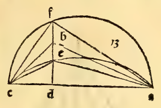
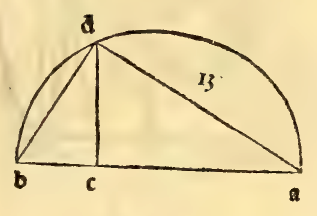
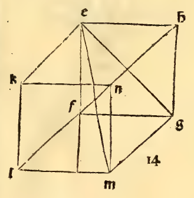
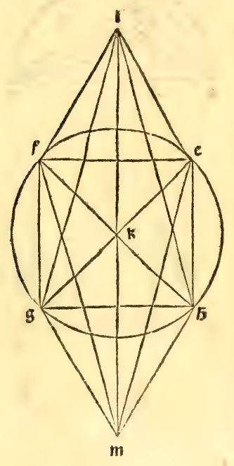

:layout: book

.. _compendio-cap_28-de:

CAPITEL XXVIII (Deutsch — Winterberg 1889)
==========================================

.. rubric:: Wie das Oktaeder gebildet wird, welches genau in die Kugel sich beschreiben lässt, und sein Verhältniss zur Kugel.

.. container:: track-nav

   :ref:`English <compendio-cap_28-en>` · :ref:`Italiano (1509) <compendio-cap_28-it>` · **Deutsch (1889)** · :ref:`Notes <compendio-cap_28-notes>` | :ref:`Conspectus <compendio-index>` · :ref:`← Prev <compendio-cap_27-de>` · :ref:`Next → <compendio-cap_29-de>`

.. folio:: 0033–0034 (f. 9r–f. 9v)
   :initial: 0033.c1.png

Es ist drittens der aus acht Dreieckflächen bestehende Körper zu construiren, das sogenannte Oktaeder, der ebenfalls von einer angenommenen Kugel genau umschlossen sein soll, von welcher Kugel allein der Durchmesser uns bekannt sei. Und das geschieht auf folgende Art: Man nehme den Durchmesser der Kugel, welches die Linie ab sei, die man im Punkte c halbire, und über der ganzen Linie schlage man den Halbkreis abd und ziehe cd senkrecht zur Linie ab; und sodann verbinde man den Punkt d mit dem Endpunkte des genannten Durchmessers, nämlich mit a und mit b. Sodann bilde man ein Quadrat, dessen sämmtliche Seiten gleich der Linie bd sind, und dies Quadrat sei efgh. Und in diesem Quadrate ziehe man zwei Durchmesser, wovon der eine eg, der andere fh sei. Diese schneiden sich unter einander im Punkte k. Daher ist nach der vierten des ersten klar, dass jeder dieser Durchmesser gleich der Linie ab ist, die als Durchmesser der Kugel angenommen wurde, indem der Winkel d nach dem ersten Theile der dreissigsten des dritten ein rechter ist. Und weiter ist jeder der Winkel e, f, g, h ein rechter, nach der Definition des Quadrats. Und ferner ist klar, dass jene beiden Durchmesser eg und fh sich

') seil. Kubus.

2iq

unter einander zu gleichen Theilen im Punkte k theilen. Und es erhellt leicht durch Ableitung aus der fünften und zweiunddreissigsten und sechsten des ersten. Nun errichte man über k die Linie kl senkrecht zur Ebene des Quadrats: welche Senkrechte man gleich der Hälfte des Durchmessers eg oder flx mache; und dann lasse man die Hypotomisseni) le, If, lg, Ih herab. Und alle diese Hypotomissen werden nach dem Vorerwähnten und Vorausgesetzten, mittelst der vorletzten des ersten, die so oft wie es nöthig wiederholt angegeben, unter sich und ebenso gleich den Seiten des Quadrats sein. Wir haben also bis hierher eine Pvramide von vier gleichseitigen Dreiecksflächen über dem genannten Quadrate erreicht, welche Pyramide die Hälfte des achtflächigen Körpers ist, den wir suchen. Machen wir sodann unterhalb des genannten Quadrats eine andere, dieser ähnliche Pyramide auf dieselbe Art, nämlich : Wir werden die genannte Linie Ik ziehen, indem sie das genannte Quadrat durchbohrt und durchdringt bis zum Punkte m, in der Art, dass die Linie km, welche sich unterhalb des Quadrats befindet, gleich der Linie Ik sei, die über dem genannten Quadrate steht. Und sodann werde ich den Punkt m mit allen Eckpunkten des Quadrats verbinden, indem ich vier andere hypotomissenartige Linien, nämlich me, mf, mg, mh ziehe. Und auch von diesem wird nach der vorletzten des ersten und den andern vorher angeführten bewiesen, dass sie unter sich und auch den Seiten des genannten Quadrats gleich seien, wie es von den andern Hypotomissen oberhalb des Quadrats bewiesen wurde. Und somit wird, wenn man stets mit Sorgfalt die oben genannten Dinge beachtet, der Körper von acht gleichseitigen Dreiecksflächen beendet sein, der genau von der Kugel umschrieben sein wird. Das Verhältniss zwischen der Kugel und dem genannten Körper ist^ dass das Quadrat des Durchmessers der Kugel zum Quadrat der Seite des genannten Körpers genau doppelt ist, d. h. wenn der genannte Durchmesser 8 wäre, so würde die Seite des Oktaeders =1X32 sein, denn deren Potenzen stehen unter einander im doppelten Verhältniss, nämlich das Quadrat

cfr. Cap. I.XXI.

des Durchmessers ist das Doppelte vom Quadrat der Seite des genannten Körpers, und so haben wir die Construction und das Verhältniss hinsichtHch der Kugel etc.

Marginal Woodcut Diagrams (Paganini 1509)
-----------------------------------------

.. figure:: 0033.g1.png
   :align: center

   Folio 0033 Diagram 1

   Folio 0033 Diagram 2

   Folio 0033 Diagram 3

   Folio 0033 Diagram 4

.. figure:: 0034.g1.png
   :align: center

   Folio 0034 Diagram 1

   Folio 0034 Diagram 2
