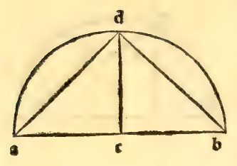
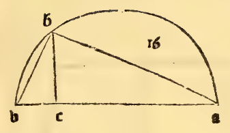
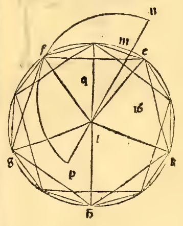

:layout: book

.. _compendio-cap_29-it:

CAPITOLO XXIX (Italiano — 1509)
===============================

.. rubric:: De la fabrica e formatione del corpo detto ycocedron.

.. container:: track-nav

   :ref:`English <compendio-cap_29-en>` · **Italiano (1509)** · :ref:`Deutsch (1889) <compendio-cap_29-de>` · :ref:`Notes <compendio-cap_29-notes>` | :ref:`Conspectus <compendio-index>` · :ref:`← Prev <compendio-cap_28-it>` · :ref:`Next → <compendio-cap_30-it>`

.. folio:: 0034–0036 (f. 9v–f. 10v)
   :initial: 0034.c1.png

Saper fare el corpo de 20 basi triangulari equilateri che aponto da vna data spera che habia el diametro rationale sia circundato. E sira euidentemente ellato del dicto corpo vna linea irrationale cioè quella che fia dieta linea menore. Verbi gratia Sia ancora qui el diametro dela data spera ala qual se ponga esser rationale o in longhezza o solo in la potenza. E diuidase nel ponto e. In modo che ae. sia quadrupla del cb. e faciase. sopra lei el semieirculo adb. etirise ed. perpendiculare al ab. e tirise la linea db. Dapoi secondo la quantità de la linea db. se facia el cerchio efghk. sópra el centro 1 al quale se inscriua vn pentagono equilatero de le medesime anotato. Ali anguli del quale dal centro 1 semenino le linee le . If . Ig . Ih . Ik. E ancora nel medesimo cerchio se faria vndecagono equilatero. Dividinse adonca tutti li archi per equali de liquali le cordo sonno li lati del pentagono. E dali ponti medii al extremita de tutti li lati, de lo inscripto pentagono se dirizino le linee recte. E ancora sopra tutti li anguli del dicto pentagono se dirigi el cateto commo insegna la duodecima del vndecimo liquali cadauna ancora sia equale ala linea bd. E congionghinse le extremita de questi 5 cateti con 5 corausti. E siranno per la sexta del vndecimo li 5 cateti cosi derigati fraloro equidistanti. E conciosia che loro sienno equali siranno ancora per la tregesimaterza del primo li 5 corausti quali congiongano le loro extremita equali ali lati del pentagono. Lascia cadere adonca da cadauna sumita de tutti li cateti doi e doi ypotumise ali dai anguli circunstanti del decagono ^ inscripto. E le extremita de queste deci ypotomisse quali descendano dale 5 extremita de li cateti ali 5 ponti quali sonno cadauni anguli medii del decagono inscripto congiungi formando vnoaltro pentagono nel dicto cerchio. El quale ancora sira equilatero per la vigesimaterza del terzo. E quando arai facto questo ve

1. congiunti formano.

derai che arai facto io trianguli de li quali li lati sonno le io ypotomise eli 5 corausti. eli 5 lati de questo pentagono inscripto. E che questi trianguli sienno equilateri cosi lo aprenderai. Conciosia che tanto el semidiametro del cerchio descripto quanto che cadauna de li cateti derizati sia equale ala linea bd. per la ypothesi sira per lo corelario de la i5. del 4 cadauno de li cateti equale allato delo exagono equilatero facto nel cerchio del quale el diametro i) fia equale ala linea bd. E perche per la penultima del primo cadauna dele io ypothemise tanto e più potente del cateto quanto pò ellato del decagono ancora per la decima del terzodecimo ellato del pentagono e tanto più potente del medesimo quanto pò el medesimo lato del decagono sira per la comuna scientia cadauna de queste ypotomise equale allato del pentagono. E deli corausti già e stato mostro che loro sienno equali ali lati del pentagono. Onde tutti li lati de questi IO trianguli o veramente sonno lati del pentagono equilatero la secunda volta alcerchio inscripto o veramente aquelli equali. Sonno adonca li dicti trianguH equilateri. Ancora più sopra el centro del cerchio qual fia el ponto 1 deriza vnaltro catheto equale ali primi qual sia Im. E la sua superiore extremita qual fia el ponto m giogni con cadauna extremita deli primi con 5 corausti. E sira per la sexta del vndecimo questo catheto centrale cioè che fia derizato nel centro equidistante a cadauno deli catheti angulari. E pero per la trigesimaterza del primo questi 5 carausti siranno equali al semidiametro del cerchio e per lo correlano de la decimaquinta del quarto cadauno fia commo lato delo exagono.

Adunca al dicto catheto centrale da luna elaltra parte sa gionghi vna linea equale allato del decagono cioè de sopra in su li sagionga mn. E in giù sotto al cerchio li sagionga dal centro del cerchio Ip. Dapoi se lascino cadere dal ponto n 5 ypotomise ali 5 anguli superiori deli io trianguli quali sonno interno alarcuito. E dal ponto p. altri 5 ali altri 5 anguli inferiori. E siranno queste io ypothomise equali fraloro ali lati delo inscripto pentagono per la penultima del primo e per la decima del terzodecimo si commo de le altre io fo demostrato

') Soli heissen : semidiametro.

prima. Hai adonca el corpo de 20 basi triangulari e equilatere del quale tutti li lati sonno equali ali lati del pentagono. E lo suo diametro fia la linea np. E de queste 20. trianguii io ne stanno nel circuito sopra el cerchio, E 5 se eleuano in su concurrenti al ponto n. E li altri 5 concorrano de sotto al cerchio nel ponto p. E questo corpo chiamato icocedron cosi formato che la data spera aponto el circondi cosi sira manifesto. Conciosia che la linea Ira. sia equale allato delo exagono. E la linea mn. allato del decagono quali sienno equilateri circumscripti ambe doi del medisimo cerchio efg. tutta In. sira per la nona del terzodecimo diuisa secondo la proportione hauente el mezzo e doi extremi nel ponto m. e la sua magior parte sira la linea Im. diuidase adonca Im. per equali nel ponto q. e sira per la comune scientia pq. equale al qn . peroche pi . fia posto equale al lato del decagono sì commo mn. Onde qn. fia la Y2 de np. si commo qm. fia mita de mi. Conciosia adoncha chel quadrato nq. sia per la terza del terzodecimo quincuplo al quadrato qm. sira ancora per la quinta decimo del quinto el quadrato pn. quincuplo al quadrato Im. Peroche per la quarta del secondo el quadrato pn. fia quadruplo al quadrato qn. Elo quadrato ancora Im. quadruplo al quadrato qm. per la medesima. E lo quadruplo al quadruplo fia commo el simplo: al simplo commo afferma la quintadecima del quinto. E lo quadrato ab fia quincuplo al quadrato bd. per la secunda parte del corelario dela octaua del sexto. E per lo correlaro dela decimaseptima del medesimo. Peroche ab. ancora e quincuplo al bc. Peroche ac fo ala medesima quadruplo. Perche adonca Im. fia per la ypothesi equale al bd. sira per la comune scientia ab. equale al np. Onde se sopra la linea np. se farla el semicirculo. El qual se mene intorno finche torni al primo luogo donde se conmezo amouere quella spera che sira facta pel suo moto sira (per la diffinitione dele spere equali) equale ala spera proposta. E perche la linea Im. fia nel medio luogo proportionale in fra In. e nm. E pero infra In. e pi. Sira ancora cadauno semidiametro del cerchio nel medio luogo proportionale infra in. e Ip. E conciosia che Im. sia equale al semidiametro del cerchio. Onde el semicirculo descripto sopra pn. passata per tutti li ponti dela circumferentia del cerchio efg. E pero ancora per tutti li anguli del fabricato solido quali stanno in quella circumferentia. E per che per la medesimo ragione tutti li corausti (quali congiongano le extremita delli catheti angulari con la extreraita del centrale) sonno nel medio luogo proportionali infra pm. e mn. Impero che cadauno depsi fia equale al Im. Sequita chel medesimo semicirculo passi ancora per li altri angoli dela figura ycocedra cosi fabricata. Fia adunca questo dal corpo inscriptibile in la spera de la quale el diametro fia pn. E pero ancora ala spera dela quale el diametro fia ab. Elo lato de questa solida figura dico essere la linea menore. Pero che glie manifesto che la linea bd fia rationale in potenza conciosia chel suo quadrato sia el quinto del quadrato de la linea ab. la qual fo posta rationaie o in longhezza o vero solo in potenza. Onde el semidiametro eli semidiametri del cerchio efg. fia ancora rationale in potenza. Perochel suo semidiametro fia equale al bd. Adonca per la duodecima del decimotertio ellato del pentagono equilatero a questo cerchio inscripto fia la linea menore. E ancora si commo nel processo de questa demonstratione fo mostro ellato de questa figura e quanto ellato del pentagono. Adoncha ellato de questa figura de 20 basi triangulari equilatere fia la linea menore si commo se presupone.

Marginal Woodcut Diagrams (Paganini 1509)
-----------------------------------------

   Folio 0034 Diagram 1

.. figure:: 0034.g2.png
   :align: center

   Folio 0034 Diagram 2

   Folio 0035 Diagram 1

   Folio 0035 Diagram 2

.. figure:: 0036.g1.png
   :align: center

   Folio 0036 Diagram 1
