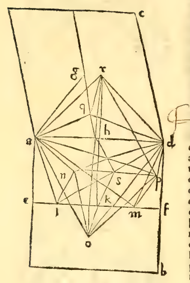

:layout: book

.. _compendio-cap_30-de:

CAPITEL XXX (Deutsch — Winterberg 1889)
=======================================

.. rubric:: Den Körper aus zwölf gleichseitigen und gleichwinkligen Fünf- ecken herstellen zu können, so dass die angenommene Kugel ihn genau einschliesse.

.. container:: track-nav

   :ref:`English <compendio-cap_30-en>` · :ref:`Italiano (1509) <compendio-cap_30-it>` · **Deutsch (1889)** · :ref:`Notes <compendio-cap_30-notes>` | :ref:`Conspectus <compendio-index>` · :ref:`← Prev <compendio-cap_29-de>` · :ref:`Next → <compendio-cap_31-de>`

.. folio:: 0036–0038 (f. 10v–f. 11v)

Die Seite des genannten Körpers wird offenbar irrational sein, was Rest genannt wird. Man zeichne einen Kubus auf die von uns gelehrte Art, so dass ihn die angenommene Kugel genau umgebe. Und es seien von diesem Kubuo die beiden Oberflächen ab und ac, und stellen wir uns jetzt vor, dass ab die obere davon, und die Fläche ac eine der Seitenflächen sei. Und die Linie ad sei diesen beiden Flächen gemeinsam. Man halbire nun in der Fläche ab die zwei gegenüberliegenden Seiten, nämlich bd und die ihr gegenüberstehende Seite und verbinde die Theilpunkte mittelst der Linie ef. Und ebenso halbire man die Seite ad und die ihr gegenüberliegende in der Fläche ac, und die Theilpunkte verbinde man durch eine gerade Linie, deren Hälfte gh sei, und es sei der Punkt h der Mittelpunkt der Linie ad. Ebenso halbire man die Linie ef im Punkt k und ziehe hk. Sodann wirst du jede der drei Linien ek, kf und hg nach der Proportion, die einen mittlem und zwei äussere Abschnitte hat in den drei Punkten l, m, q, theilen und es seien ihre grössern Abschnitte Ik, km, gq, die offenbar einander gleich sind, sofern alle getheilten Linien gleich, d. h. jede von ihnen gleich der halben Kubusseite war. Sodann errichte in den beiden Punkten / und m die Senkrechten auf der Fläche ab (wie es die zwölfte des eilften lehrt), deren jede du gleich der Linie kl setzen wirst, i und zwar seien dies In und mp. Ebenso errichte im Punkte q senkrecht zur Fläche ac

die Linie qr, die du gleich gq machst. Ziehe sodann die Linien al, an, am, ap; dm, dp, dl, dn; ar, aq; dr, dq. Dann ist nach der fünften des dreizehnten offenbar, dass die Summe der Quadrate der beiden Linien kl und el dreimal so gross ist, wie das der Linie klA und darum auch, wie das der Linie In, sofern kl und In einander gleich sind. Und es ist auch ke = ea. Also ist die Potenzsumme der zwei Linien ae und el gleich dem dreifaclien der von /«.Daher ist nach der Vorletztendes ersten al'^ = 3 Zn-, und folghch ist nach derselben ^«2=^4 ^„2. u^j sof^m das Quadrat 'jeder Linie das Vierfache des Quadrats ihrer Hälfte, so folgt nach gemeinem Wissen, dass an doppelt so lang als In. Und weil Im das Doppelte von Ik und ausserdem Ik und In einander gleich sind, so wird an = Im sein, da ihre Hälften gleich sind. Und weil nach der dreiunddreissigsten des ersten Im = np, so wird auch an = np sein. Und auf dieselbe Art wirst du beweisen, dass die drei Linien pd, dr und ra unter sich und den beiden vorgenannten gleich sind. Wir haben daher durch diese fünf Linien das gleichseitige Fünfeck, nämhch a, n, p, d, r. Aber vielleicht wirst du sagen, es sei kein Fünfeck, weil es vielleicht nicht ganz in ein und derselben Ebene liegt, was nothwendig ist, damit es ein Fünfeck sei. Und dass es ganz in ein und derselben Oberfläche hege, wirst du folgendermassen erkennen: Es möge vom Punkte k aus die Linie ks senkrecht zur Ebene ab ausgehen, welche gleich Ik sei : dann wird sie deswegen gleich jeder der beiden In und mp sein, und sofern sie von jeder der beiden der sechsten des elften gemäss, gleich weit absteht. Daher muss mit beiden in derselben Ebene, nach der Definition äquidistanter Linien nothwendig der Punkt s in der Linie np sich befinden, und dieselbe halbiren. Man ziehe nun die beiden Linien rh und hs. Dann sind die beiden Dreiecke ksh und qrh über einem Winkel (nämhch khq) gelegen. Und es findet die Proportion statt: kh:qr=zks:qh, da sich nach der siebenten des fünften gh:qr = kh : qr, und nach ebenderselben rq : qh = ks : qh ver- •hält. Aber es verhält sich: gh:qr=qr:qh, da qr = qg. Daher ist zufolge der dreissigsten des sechsten die Linie rhs eine

Es sei erlaubt, hier und im Folgenden einige mathematische Abkürzungen der bessern Uebersicht wegen gelegentlich anzubringen.

einzige Grade. Daher liegt nach der zweiten des elften das in Rede stehende Pentagon in ein und derselben Ebene. Ich behaupte noch, dass es gleichwinklig sei, was so erhellt. Denn sofern eÄ;nach der stetigen Proportion getheilt, und km ihr grösserer Abschnitt, so wird auch nach der vierten des dreizehnten die ganze em stetig getheilt, und ihr grösserer Abschnitt die Linie ek sein, daher auch nach der fünften die zwei Linien em und mk, und deswegen die zwei: em und mp, da mp = mk ist. Die Summe der Quadrate der beiden letzteren ist gleich dem dreifachen Quadrate von ek, und auch von ae, weil ae = ek ist Daher ist die Summe der Quadrate der drei Linien ae, em, mp gleich dem vierfachen Quadrate der Linie ae. Es ist ausserdem nach der schon zweimal erwähnten vorletzten des elften klar, dass das Quadrat der Linie ap gleich der Summe der drei Quadrate der Linien ae, em, mp ist. Daher ist das Quadrat von ap gleich dem vierfachen Quadrat von ae. Und da die Kubusseite das Doppelte von ae, so ist nach der vierten des zweiten auch ihr Quadrat das Vierfache jener. Daher ist nach geraeinen Wissen ap gleich der Kubusseite. Und sofern ad eine der Kubusseiten ist, wird ap = ad sein. Und darum wird nach der achten des ersten ■< ard = -<. anp sein. Auf dieselbe Art wirst du beweisen, dass der <C dpn = <! dra sei, da du zeigen wirst, dass das Quadrat von dn gleich dem Vierfachen der halben Kubusseite ist. Insofern nun dem hier Gesagten zufolge das Pentagon gleichseitig ist und drei gleiche W^inkel hat, so wird es nach der siebenten des dreizehnten gleichwinklig sein. Wenn wir daher auf diesem Wege und mit ähnlichem Verfahren über jeder der andern Seiten des Kubus ein gleichseitiges und gleichwinkliges Pentagon errichten werden, so wird sich ein fester, von zwölf gleichseitigen und auch gleichwinkligen Pentagonen ent-

seil, wegen der aus obiger Proportion folgenden Aehnlichkeit der beiden Dreiecke ksh und qrh, da die Summe der beiden anstossenden Winkel plus dem durch die beiden Kubusflächen eingeschlossenen zusammen gleich iSo** sind.

Der Kürze wegen ist hier und im Folgenden dieser Ausdruck für den gleichbedeutenden: „nach der Proponion, die einen mittlem und zwei äussere Abschnitte'' hat, gesetzt worden.

3j seil, em und mp.

haltener Körper ergeben. Denn der Kubus hat zwölf Kanten. Es bleibt jetzt noch zu zeigen, dass ebendieser Körper genau von der gegebenen Kugel umgrenzt sei, was folgendermassen sich ergeben wird, nämlich: Man lege durch die Linie 5Ä: zwei Ebenen, welche den Kubus theilen, wovon die eine ihn in der Linie hlc, die andere in der Linie ef schneiden möge. Und nach der vierzigsten des elften wird die gemeinsame DurchschnittsUnie dieser beiden Ebenen den Durchmesser i) des Kubus halbiren und ebenso umgekehrt wird sie selbst vom genannten Durchmesser halbirt. Es sei danach ihre gemeinsame Schnittlinie bis zum Durchmesser des Kubus die Linie ko, so dass der Punkt o das Gentrum des Kubus sei. Und man ziehe die Linien oa^ on, op, od, 07', dann ist klar, dass jede der beiden Linien oa und od der Halbmesser des Kubus sei, und daher sind sie gleich. Und von der Linie ok ist nach der vierzigsten des elften klar, dass sie gleich ek, d. h. gleich der Hälfte der Kubusseite sei. Und dSi ks gleich km, so wird os im Punkte k stetig getheilt, und ihr grösserer Abschnitt ist die Linie ok, die gleich ek ist. Daher wird nach der fünften des dreizehnten die Quadratsumme der zwei Linien os und sk oder auch, weil sp = ks (auf welche dieser Beweis sich nicht erstreckt), von os und sp gleich dem dreifachen Quadrat der Linie ok, und deshalb auch der halben Kubusseite sein. Daher ist nach der vorletzten des ersten das Quadrat der Linie op gleich dem dreifachen Quadrate derselben Kubusseite. Und aus dem Corollar der vierzehnten des dreizehnten geht hervor, dass das Quadrat des Kugelhalbmessers gleich dem Dreifachen der Seite des Kubus ist, der von derselben Kugel umschlossen wird. Daher ist op dem Halbmesser der Kugel gleich, die genau den vorgelegten Kubus umschliesst. Aus demselben Grunde sind es alle Linien, welche vom Punkte o nach jeder Ecke aller Pentagone gezogen werden, die über den Kubuskanten gebildet werden, d, h. zu allen Eckpunkten, welche den Pentagonen angehören, und nicht zu denen, welche ihnen selbst und den Flächen des Kubus gemeinsam sindj d. h. ihnen ganz eigenthümlich, wie es die drei Winkelpunkte n, p, r im vorher gebildeten Fünfeck sind. Und bezüg-

cfr. Cap. LXXI.

lieh der Linien, die vom Punkte o zu allen Ecken der Pentagone gelangen, die den Pentagonen und den Kubusflächen gemeinsam sind, wie es in dem vorgelegten Pentagon die beiden Ecken a und d sind, ist klar, dass sie gleich dem Halbmesser der Kugel sind, welche den Kubus genau umgibt; da sie zufolge der vierzigsten des elften Durchmesser des Kubus sind. Aber der Halbmesser des Kubus ist gleich dem Halbmesser der Kuoel, die ihn genau umschliesst, wie es aus dem Raisonnement der vierzehnten des dreizehnten erhellt. Daher sind alle Linien, die vom Punkte o aus zu allen Ecken des Dodekaeders, d. h. desjenigen Körpers der von zwölf gleichseitigen und gleichwinkligen Pentat^onen umschlossen ist, der im Griechischen so genannt wird, unter sich, und dem Halbmesser der Kugel gleich. Wenn daher der über dem ganzen Kugeldurchmesser, oder genau über dem Kubus beschriebene Halbkreis rings herum gedreht wird, so wird er durch alle seine Eckpunkte hindurch gehen. Daher wird nach der Definition derselbe genau von der bestimmten Kugel umschlossen. Ich behaupte noch, dass die Seite dieser Figur eine irrationale Linie sei, d. h. eine solche, die man Rest nennt, wenn der Durchmesser der Kugel, welche sie genau umschliesst, rational ist bezüglich seiner Länge oder deren Quadrat, was so erhellt: Sofern der vierzehnten des dreizehnten zufolge das Quadrat des Kugeldurchmessers gleich dem dreifachen Quadrate der Kubusseite ist, so wird das Quadrat der letzteren rational sein, wenn der Kugeldurchmesser selbst oder sein Quadrat rational ist. Und aus der elften des dreizehnten ist klar, dass die Linie rp die Linie ad, welche Kubusseite ist, stetig theilt, und dass ihr grösserer Abschnitt gleich der Pentagonseite ist. Und weil ihr grösserei Abschnitt der sechsten des dreizehnten zufolge Rest ist, so ist klar, dass die Seite der in Rede stehenden Dodekaeder genannten Figur Rest sei, was wir haben beweisen wollen.

Marginal Woodcut Diagrams (Paganini 1509)
-----------------------------------------

   Folio 0036 Diagram 1
