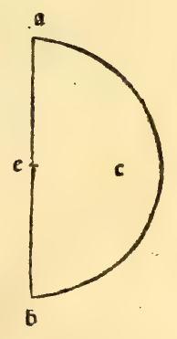

:layout: book

.. _compendio-cap_55-it:

CAPITOLO LV (Italiano — 1509)
=============================

.. rubric:: Del modo asaperne oltra li dicti più formare e commo lor forme in infinito procedano.

.. container:: track-nav

   :ref:`English <compendio-cap_55-en>` · **Italiano (1509)** · :ref:`Deutsch (1889) <compendio-cap_55-de>` · :ref:`Notes <compendio-cap_55-notes>` | :ref:`Conspectus <compendio-index>` · :ref:`← Prev <compendio-cap_54-it>` · :ref:`Next → <compendio-cap_56-it>`

.. folio:: 0048–0049 (f. 16v–f. 17r)
   :initial: 0048.c1.png

Non me pare excelso Duca in dicti corpi più extendermi conciosia chel lor processo tenda in infinito per la continua e successiua abscisione de mano in mano de li suoi anguli solidi e secondo quella lor varie forme se vengano multiplicare. E queste dase siandoli lauia per li già dicti aperta porrà sequili perche sempre fia dicto quod facile est inventis addere. Non e difficile larogere ale cose trouate epero più o manco leuando egiognendo alepredette sira facile a ogni proposito. E questo solo habiamo finor sequito per monstrare commo da quelli 5 regulari lauirtu sempre neglialtri dependenti se distilla asimilitudine deli 5 semplici che ala formatione de ogni creato composto concorrano.

Per la qual cosa (commo de sopra fo acenato) :person:`Platone <plato>` fo constretto le prelibate 5 formi regulari ali 5 corpi semplici atribuire cioè ala terra aiere aqua fuoco e cielo commo difusamente apare nel suo Thimeo doue dela natura deluniuersa tratto. E alo elemento dela terra atribui la forma cubica cioè quella de lo :term:`exacedron <exahedron>` conciosia che al moto ninna figura habia bisogno de magior violenza. E infra tutti li elementi che si troua più fixa constante e ferma che latterra.

Equella del :term:`tetracedron <tetrahedron>` la dette alo elemento del fuoco pero che volando in su causa la forma pyramidale chel simile el nostro fuoco alochio cilfa aperto peroche noi vediamo quello al piano e in basso largo e uniforme sempre in • su degradare in modo che sua fiama la cima in vn ponto termina si commo su el cono de ogni pyramidc la forma deloctocedron la tribui alaere. Peroche si commo Uiierc a vn piccol mouimento se quiu. el fuoco cosi la forma pyramidale i) sequita per la habilita al moto la forma de la Pyramide. Eia figura del 20 basi cioè delo :term:`ycocedron <icosahedron>` ladeputo alaqua.

Perochó conciosia che lasia circundata de più basi che alcuna de laltre: li parse che la conuenisse in la :term:`spera <spera>` più presto al moto dela cosa che spargendo scende: che de quella che ascende. Eia forma del 1 2 basi pentagone atribui al cielo si commo a quello che e receptaculo de tutte le cose, questo :term:`duodecedron <dodecahedron>` el simile fia receptaculo e albergo de tutti glialtri 4 :term:`corpi regulari <corpi-regulari>` commo apare in le loro inscriptioni vno in laltro. E ancora commo dici Alcinouo sopra el :cite:`Timeo <plato:timaeus:53c-56c>` de :person:`Platone <plato>`, perche si commo nel cielo sonno 12 segni nel suo zodiaco e ognuno de quelli in 30 equali parti se diuide che tutta la sua annuale reuolutione fia 360.

Cosi questo :term:`duodecedron <dodecahedron>` ha in se 12 basi pentagone de lequali ognuna in 5 trianguli resoluta fermando el ponte in mezzo e ognuno de dicti triangoli in 6 scaleni: che in tutte basi son 3o triangulari per vna: che fra tutte sonno 360 commo dicto zodiaco. E queste tali forme da :person:`Calcidio <chalcidius>` celeberrimo philosopho exponendo el dicto :cite:`Timeo <plato:timaeus:53c-56c>` molto sonno commendate. E cosi da :person:`Macrobio <macrobius>`.

:person:`Apuleio <apuleius>` e moltissimi altri: perche in vero sonno de ogni commend,atione degni, per le ragioni che in loro fabriche se aducano mostrando la sufficientia de diete 5 forme si commo el numero de dicti simplici non si pò in natura accrescere, cosi queste 5 regulari non e possibile asegnarne più che de basi e de lati e de anguli sienno equali: e che in :term:`spera <spera>` collocati toccando vnangolo tutti tocchino. Perche se in natura se potesse vn sexto corpo semplice asegnare el sumrao opefice verebbe a esser stato in le sue cose diminuto e senza prudenza da giudicarlo, non hauendo a principio tutto el bisogno oportuno a lei cognosciuto.

E per questo certamente e non per altro mosso comprendo :person:`Platone <plato>` queste tali commo e dicto a ciascuno deli dicti semplici altribuisse cosi argumentando: cioè commo buonissimo geometra e profondissimo mathematjco. vedendo le 5 varie forme de questi non poter per alcun modo alcunaltra che al sperico tenda de lati basi e angoli commo e dicto equali ymaginarse ne formare commo in la penultima del 13. se mostra e per noi aloportuno saduci non immeritamente argui le ditte aduenire ali 5 semplici. Eda quelli ognaltra forma dependere.

E auenga che questi 5 sienno soli chiamati regulari non pero se exclude la :term:`spera <spera>` che non sia sopra tutti regularissima: e ognaltro da quella deriuarse commo dala causa dele cause più sublime: e in lei non e varietà alcuna ma vniformita per tutto e in ogni luogo ha suo principio e fine e dextro e sinistro. La cui forma onde se causi qui sequente ponendo fine a dicti dependenti lo diremo: e successiuamente de tutti glialtri corpi oblonghi: cioè che più longhi che larghi sonno.

Marginal Woodcut Diagrams (Paganini 1509)
-----------------------------------------

.. figure:: 0049.g1.png
   :align: center

   Folio 0049 Diagram 1

   Folio 0049 Diagram 2
