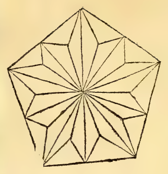

:layout: book

.. _compendio-cap_56-en:

CHAPTER LVI (English)
=====================

.. rubric:: On the Spherical Body and How It Is Formed (Plates XLI–XLII).

.. container:: track-nav

   **English** · :ref:`Italiano (1509) <compendio-cap_56-it>` · :ref:`Deutsch (1889) <compendio-cap_56-de>` · :ref:`Notes <compendio-cap_56-notes>` | :ref:`Conspectus <compendio-index>` · :ref:`← Prev <compendio-cap_55-en>` · :ref:`Next → <compendio-cap_57-en>`

.. folio:: 0049–0050 (f. 17r–f. 17v)
   :initial: 0049.c1.png

.. enunciation:: Definition and Generation of the Sphere (:just:`XI.Def.14`)

   The sphere is a solid figure described by the revolution of a semicircle when its diameter remains fixed and the semicircle is turned completely around until it returns to the place from which it began to move; and the center of the sphere is the same as the center of the semicircle (:just:`XI.Def.14`).

The sphere has been defined in various ways by many authors—above all by the worthy mathematician **Dionysius** (and Theodosius in his *Sphaerica*, who defines it as a solid body bounded by a single surface, within which there is a point from which all straight lines drawn to the surface are equal). Yet our author **Euclid**, with supreme brevity, describes its genetic formation in the :just:`eleventh book <XI.Def.14>` in a definition adopted by all posterity (and depicted in perspective in :ref:`Plate XLI (Sperico Solido) and Plate XLII (Sperico Vacuo) <plates-polyhedra-en>`):

.. assertion:: Construction of the Sphere by Revolution (:just:`XI.Def.14`)

   1. Let :math:`adb` be a semicircle constructed upon any straight line :math:`ab` as diameter, with center :math:`c` and curved circumference :math:`adb` (see the marginal diagrams ``0049.g1.png`` and ``0049.g2.png`` on Folio 0049).
   2. Hold the diameter :math:`ab` fixed like an immovable axle (*axe*), and revolve the plane semicircle :math:`adb` completely around :math:`ab`—starting from point :math:`d`, descending through the lower half, and rising through the upper half (or conversely) until the arc :math:`adb` returns to the exact place from which it began to move.
   3. The round solid body traced out (*el vestigio*) by the plane semicircle in its complete revolution is called a **spherical body** or **sphere** (*corpo sperico / spera*), and its center is the same point :math:`c` which was the center of the semicircle.
   4. And to grasp this properly in the imagination, conceive of the semicircle as a flat material half-trencher (*vn mezzo taglieri materiale*): for if only the curved line of the arc revolved without the plane surface inside it, it would leave only a hollow shell without solid body, since a line has neither breadth nor depth (:just:`I.Def.2`).

.. qed::

Marginal Woodcut Diagrams (Paganini 1509)
-----------------------------------------

   Folio 0049 Diagram 1

.. figure:: 0049.g2.png
   :align: center

   Folio 0049 Diagram 2
