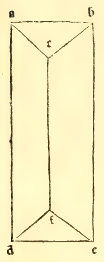

:layout: book

.. _compendio-cap_60-de:

CAPITEL LX (Deutsch — Winterberg 1889)
======================================

.. rubric:: Von den vierseitigen kantigen Säulen.

.. container:: track-nav

   :ref:`English <compendio-cap_60-en>` · :ref:`Italiano (1509) <compendio-cap_60-it>` · **Deutsch (1889)** · :ref:`Notes <compendio-cap_60-notes>` | :ref:`Conspectus <compendio-index>` · :ref:`← Prev <compendio-cap_59-de>` · :ref:`Next → <compendio-cap_61-de>`

.. folio:: 0052–0053 (f. 18v–f. 19r)
   :initial: 0052.c1.png

XLIII. XLVI. Von den kantigen ist die zweite Sorte vierseitige, und zwar sind es die, welche zwei auf besagte Art vierseitige Basen haben, und vier andere Oberflächen, die sie umgeben, sind ebenfalls vierseitig, gleich weit von einander entfernt, je nachdem sie sich gegenüberstehen, und diese sind ebenfalls bald gleich, bald ungleichseitig, der Beschaffenheit ihrer Grundflächen entsprechend. Denn von den ebenen vierseitigen gradlinigen Figuren bestimmen sich vier Arten: die eine Quadrat genannt, ist die, welche sammtliche Seiten gleich, und als Winkel rechte hat, wie hier neben die Figur AA) Die andere, verlängertes Tetragon genannt, ist die, welche gleiche Gegenseiten und gleicher Art rechte Winkel hat, aber länger als breit ist, wie die nebenstehende Figur B. Die dritte Sorte wird Elmuaym genannt, welches eine gleichseitige aber nicht rechtwinklige Figur ist^ und wird mit anderm Namen Rhombus genannt, wie hier die Figur C. Die vierte Figur wird dem Elmuaym ähnliche oder Rhomboide mit anderm Namen genannt, wobei nur ihre Gegenseiten einander gleich und unter sich von gleichem Abstände, und es hat keine rechten Winkel, wie die Figur D offenbart. Alle andern Figuren ausser diesen, welche vierseitig sind, werden Elmuariffe, d. h. unregelmässige genannt, wie es die verzeichneten Figuren E sind. Nun können sich, allen diesen Verschiedenheiten, der Grundflächen gemäss, die besagten vierseitigen Säulen ändern. Aber wie man auch will, immer rauss man den gleichen Abstand ihrer Grundflächen als Höhe dabei verstehen. Und eben diese können wir nach der Art

vgl. Fig. pag. 107.

ihrer Grundflächen regelmässige, und die übrigen unregelmässige oder Elmuariffe nennen.

Marginal Woodcut Diagrams (Paganini 1509)
-----------------------------------------

   Folio 0052 Diagram 1

.. figure:: 0053.g1.png
   :align: center

   Folio 0053 Diagram 1

.. figure:: 0053.g2.png
   :align: center

   Folio 0053 Diagram 2
