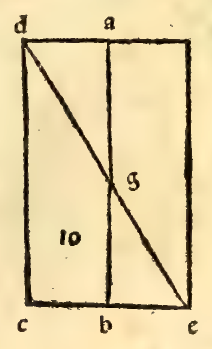

:layout: book

.. _compendio-cap_61-de:

CAPITEL LXI (Deutsch — Winterberg 1889)
=======================================

.. rubric:: Von den kantigen fünfseitigen Säulen.

.. container:: track-nav

   :ref:`English <compendio-cap_61-en>` · :ref:`Italiano (1509) <compendio-cap_61-it>` · **Deutsch (1889)** · :ref:`Notes <compendio-cap_61-notes>` | :ref:`Conspectus <compendio-index>` · :ref:`← Prev <compendio-cap_60-de>` · :ref:`Next → <compendio-cap_62-de>`

.. folio:: 0053 (f. 19r)
   :initial: 0053.c1.png

XLIX. L. Drittens hat man die fünfseitigen kantigen Säulen-, d. h. die von fünf Seitenflächen, wie hier die Figur A, B, deren jede tetragonisch oder vierseitig ist. Und die Grundflächen derartiger Säulen sind stets zwei Pentagone, d. h. zwei gradlinige Figuren von fünf Seiten oder Winkeln. Denn in allen gradlinigen Figuren kommt die Anzahl der Winkel der Zahl ihrer Seiten gleich, und ohnedies können sie nicht bestehen. Und diese haben ferner gleich- oder ungleichseitig zu sein, je nachdem es ihre Grundflächen zulassen, wie es kurz vorher von den vierseitigen kantigen gesagt, sofern einige -Pentagone gleichseitig und gleichwinklig, und andere ungleichseitig und in Folge dessen ungleichwinklig sind.

Jedes Pentagon aber, was drei unter sich gleiche Winkel hat, wird, wenn es gleichseitig ist, auch gleichwinklig sein, wie die siebente des dreizehnten zeigt. Dieses wird erwähnt, weil das Pentagon gleiche Seiten mit zwei unter sich gleichen Winkeln haben könnte, und würde doch nicht ganz gleichwinklig sein. Und diese zwei Pentagone, d. h. oberes und unteres, hat man ebenfalls mit gleichem Abstände bezüglich ihrer Hohe in besagter Säule zu verstehen, mögen die Säulen nun gleichseitig oder ungleichseitig sein, wie man will.

Und weil, erhabener Herzog, die Arten der kantigen Säulen ins Unendliche anwachsen können, der Verschiedenheit der gradlinigen Figuren von mehr oder weniger Seiten entsprechend: Da bei jeder kantigen Säule ihre beiden Grundflächen, d. h. höchste und tiefste, nothwendigerweise zwei gradlinige gleiche Figuren sein müssen, d. h. dass sie in der Seitenzahl übereinstimmen, so dass nicht etwa die eine Basis drei, die andere vierseitig ist, und auch von gleichen Seiten und Winkeln unter einander der Gleichartigkeit der Säulen entsprechend, wie verschieden sie auch Varietäten unter sich machen mögen, indem sie dieselben bald gleichseitig und bald ungleichseitig bilden, deswegen scheint es mir nicht am Platze, mich in den genannten weiter zu verbreiten, sondern nur in Erinnerung zu bringen, dass ihre Benennung stets von den Grundflächen abgeleitet wird, d. h. je nachdem die Basen sind, werden sie benannt, z. B. wenn die Basen dreieckig sind, wie es vorher bei dem riegelförmigen Körper der Fall, so werden sie dreiseitig genannt.

Und wenn dieselben tetragonisch oder vierseitig sind, werden sie vierseitige genannt, und wenn pentagonisch, fünfseitige, und wenn sie von sechs Seiten, werden sie sechsseitige genannt u. s. f. Aber mögen die Grundflächen sein, welcherart sie wollen, stets werden die Seitenflächen jeder vierseitig, rechtwinklig sein. Und von beiden der bis hierher erwähnten, zeigen ihre materiellen Formen dem Auge, was hinsichtlich der Zahl gesagt, in ihrer Tabelle dargestellt. Und auch bei diesem i) hier unten in der ebenen in Perspective gesetzten Figur hinsichtlich derselben Anzahl, wie Euer Hoheit wird ersehen können.

Marginal Woodcut Diagrams (Paganini 1509)
-----------------------------------------

.. figure:: 0053.g1.png
   :align: center

   Folio 0053 Diagram 1

   Folio 0053 Diagram 2
