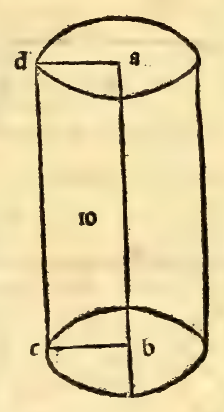
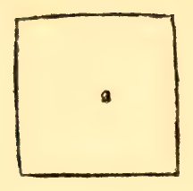
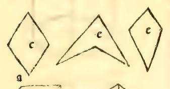
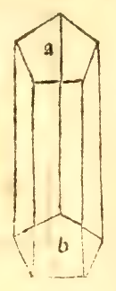

:layout: book

.. _compendio-cap_62-en:

CHAPTER LXII (English)
======================

.. rubric:: On the Way to Measure All Kinds of Columns, and First the Round Columns (Cylinders).

.. container:: track-nav

   **English** · :ref:`Italiano (1509) <compendio-cap_62-it>` · :ref:`Deutsch (1889) <compendio-cap_62-de>` · :ref:`Notes <compendio-cap_62-notes>` | :ref:`Conspectus <compendio-index>` · :ref:`← Prev <compendio-cap_61-en>` · :ref:`Next → <compendio-cap_63-en>`

.. folio:: 0053–0054 (f. 19r–f. 19v)
   :initial: 0053.c1.png

Having described the forms of all columns, it is now fitting to give Your Ducal Highness the general rule for **measuring their solid capacity or volume** (*massa corporea / capacita*)—which, although treated at full length in our great work (:cite:`*Summa de Arithmetica* <pacioli:summa>`), we summarize here briefly, beginning with **round columns** (cylinders).

.. enunciation:: General Rule for the Volume of a Round Column (Cylinder)

   First find the area of one of its circular bases by squaring the diameter of the base and taking **eleven-fourteenths** (:math:`\frac{11}{14}`) of that square, according to the close approximation discovered by the noble geometer :person:`**Archimedes** <archimedes>` in his book *De quadratura circuli* (*On the Measurement of the Circle*). Then multiply the area of the circular base by the **altitude** (*altezza*) of the column; the final product is the solid volume (*massa corporea*) of the entire round column:

   .. math::

      \text{Area}_{\text{base}} \approx \frac{11}{14}\,d^{2}, \qquad \text{Volume}_{\text{cylinder}} = \text{Area}_{\text{base}} \times h \approx \frac{11}{14}\,d^{2}\,h

.. assertion:: Worked Numerical Example and Geometric Explanation

   1. Let :math:`abcd` be a round column whose altitude :math:`ac = bd` is :math:`10` (*braccia*, *piedi*, *passi*, or *palmi*), and let the diameter of each circular base :math:`ab = cd` be :math:`7` (see the marginal diagrams ``0054.g7.png`` and ``0054.g8.png`` on Folio 0054).
   2. Multiply the diameter :math:`7` by itself:

      .. math::

         7 \times 7 = 49

   3. Take **eleven-fourteenths** (:math:`\frac{11}{14}`) of :math:`49`:

      .. math::

         \frac{11}{14} \times 49 = 38\frac{1}{2}

      which is the plane area of the circular base.
   4. Multiply this base area :math:`38\frac{1}{2}` by the altitude :math:`10` of the column:

      .. math::

         38\frac{1}{2} \times 10 = 385

   5. We say that the solid capacity (*capacita ouer aria corporale*) of the entire round column is **385 cubic units** (*385 quadrettini cubici*)—meaning that if the units are *braccia*, the column contains **385 little cubes** (*commo dadi*), each 1 *braccio* long, 1 *braccio* wide, and 1 *braccio* high (as shown in the marginal cube diagram ``0054.g7.png``).
   6. **Why Eleven-Fourteenths (:math:`\frac{11}{14}`) Is Taken**: Because :person:`Archimedes <archimedes>` demonstrated with great approximation (since the exact quadrature of the circle has not yet been found by any sage, though it varies by very little) that the ratio of the circle to the circumscribed square on its diameter (:math:`abcd` circumscribing the circle of diameter :math:`ef` with center :math:`g`, in diagram ``0054.g8.png``) is as **11 to 14** (:math:`\frac{\pi}{4} \approx \frac{11}{14}` where :math:`\pi \approx 3\frac{1}{7} = \frac{22}{7}`), while the four corner spandrels (*anguli*) left outside the circle inside the square :math:`abcd` take up the remaining **three-fourteenths** (:math:`\frac{3}{14}`) of the square!

.. qed::

Marginal Woodcut Diagrams (Paganini 1509)
-----------------------------------------

   Folio 0053 Diagram 1

.. figure:: 0053.g2.png
   :align: center

   Folio 0053 Diagram 2

   Folio 0054 Diagram 1

.. figure:: 0054.g2.png
   :align: center

   Folio 0054 Diagram 2

   Folio 0054 Diagram 3

.. figure:: 0054.g4.png
   :align: center

   Folio 0054 Diagram 4

.. figure:: 0054.g5.png
   :align: center

   Folio 0054 Diagram 5

   Folio 0054 Diagram 6

   Folio 0054 Diagram 7

   Folio 0054 Diagram 8
