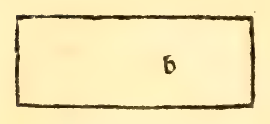
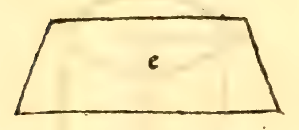
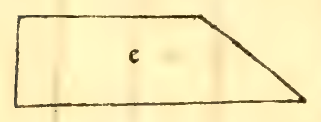

:layout: book

.. _compendio-cap_63-it:

CAPITOLO LXIII (Italiano — 1509)
================================

.. rubric:: Del modo a saper mesurare tutte le co- lonne laterate.

.. container:: track-nav

   :ref:`English <compendio-cap_63-en>` · **Italiano (1509)** · :ref:`Deutsch (1889) <compendio-cap_63-de>` · :ref:`Notes <compendio-cap_63-notes>` | :ref:`Conspectus <compendio-index>` · :ref:`← Prev <compendio-cap_62-it>` · :ref:`Next → <compendio-cap_64-it>`

.. folio:: 0054 (f. 19v)
   :initial: 0054.c1.png

XLV. XL VI. Mostrato el modo ala dimensione dele rotonde seque quello dele laterate. Per lequali smiilmente questa sia regola generale e con precisione, cioè che sempre se quadri vna dele suoi basi

qual se voglia e quel che fa poi se multiplichi nellaltezza ouer longhezza de dieta colonna. E questo vltimo producto aponto fia sua corporal massa ouer capacita. E sienno de quante se voghno facce e mai falla. Commo verbi gratia. sia la colonna laterato tetragona ab. laqual sia alta IO. eie suoi basi cadauna fìa ó per ogni verso. Dico che se quadri prima vna de diete basi, che per esser equilatere se multiplicara vn di lati in se cioè 6 in (> fa 36. e questo aponto fia el spacio dela basa. Ora dico che questo se multiplichi nellaltezza ouer lunghezza de tutta dieta colonna cioè in io farà 360. E tanti braccia ouer piedi aponto sira quadra dieta colonna, a modo che disopra dela rotonda se dicto. E cosi se le suoi basi fossero inequilatere o altramente irregulari pure secondo le norme date per noi nela dieta opera sempre se quadrino e in lor altezza el producto se multiplichi. E arasse el quesito infallibilmente in ciascuna. E per expeditione de tutte laltre questa medesima regola se deue seruare o sienno trigone, o pentagone o exagone onero eptagone. et sic de singulis. cioè che secondo la exigentia dele lor basi quelle se debino prima mesurare. Se sonno triangole per la regola deli triangoli, e se pentagone per le regole de pentagoni, e se exagone similmente Dele quali forme e figure le regole diffuse in dieta nostra opera sonno assignate. ala quale per esser facile lo accesso per la lor copiosa multitudine stampato e per luniuerso ormai diuulgata qui non curo altramente adurle e cosi a diete colonne porremo fine e sequendo diremo de lor pyramidi.

Marginal Woodcut Diagrams (Paganini 1509)
-----------------------------------------

.. figure:: 0054.g1.png
   :align: center

   Folio 0054 Diagram 1

   Folio 0054 Diagram 2

.. figure:: 0054.g3.png
   :align: center

   Folio 0054 Diagram 3

   Folio 0054 Diagram 4

   Folio 0054 Diagram 5

.. figure:: 0054.g6.png
   :align: center

   Folio 0054 Diagram 6

.. figure:: 0054.g7.png
   :align: center

   Folio 0054 Diagram 7

.. figure:: 0054.g8.png
   :align: center

   Folio 0054 Diagram 8
