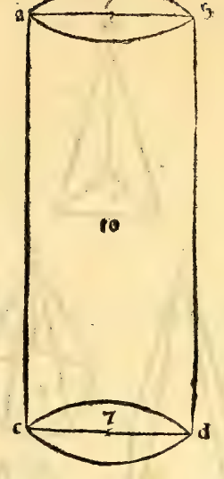
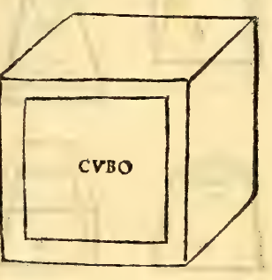
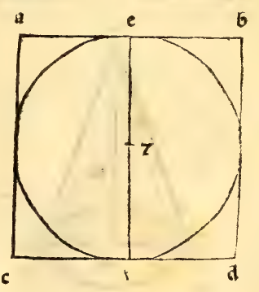
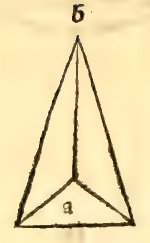
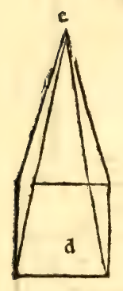
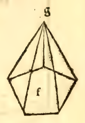
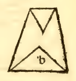
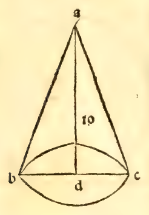

:layout: book

.. _compendio-cap_65-de:

CAPITEL LXV (Deutsch — Winterberg 1889)
=======================================

.. rubric:: Von den kantigen Pyramiden und ihren Verschiedenheiten.

.. container:: track-nav

   :ref:`English <compendio-cap_65-en>` · :ref:`Italiano (1509) <compendio-cap_65-it>` · **Deutsch (1889)** · :ref:`Notes <compendio-cap_65-notes>` | :ref:`Conspectus <compendio-index>` · :ref:`← Prev <compendio-cap_64-de>` · :ref:`Next → <compendio-cap_66-de>`

.. folio:: 0055–0056 (f. 20r–f. 20v)
   :initial: 0055.c1.png

XLIII. XLIV. Die kantigen Pyramiden, erhabener Herzog, sind unendlich vielerlei Art, wie auch die Verschiedenheiten ihrer Säulen, denen sie entstammen, wie wir nachher schliessen werden. Aber wir stellen von unserm Philosophen seine in seinem elften aufgestellte Erklärung voran, wo er sagt, die kantige Pyramide sei eine körperliche Figur, die von den Oberflächen enthalten, welche sich mit Ausnahme einer zu einem dieser gegenüberliegenden Punkte erheben. Darum ist zu bemerken, dass in jeder kantigen Pyramide alle Oberflächen, welche sie umgeben, mit Ausnahme ihrer Grundfläche sich zu einem Punkte hin erheben, welcher Spitze der Pyramide genannt wird.

Und alle solche Seitenflächen sind dreiseitig, und in den meisten Fällen ist ihre Basis nicht dreiseitig, wie z.B. hier die Pyramide A im Grundriss dreiseitig erscheint, deren Spitze B ist, und die Pyramide D vierseitig, und ihre Spitze £" und die Pyramide F pentagonisch, und ihre Spitze G und so fort, indem man bei allen, und besser noch bei ihren materiellen Formen den Zahlen: LI, LH, LUI, LIV, LV der vollen und hohlen folgt, und ausserdem in diesem in der Ebene nach ihrer perspectivischen Ansicht denselben Zahlen, und die Herleitung derselben geschieht von den eckigen Säulen, von denen wir vorher gesprochen, und zwar entstehen sie auf folgende Art: wenn man nämlich einen Punkt in einer der Grundflächen der eckigen Säule festhält, oder es sich denkt, und diesen durch gerade Linien mit jedem der gradlinig begrenzten Ecken, der andern gegenüberliegenden Basis genannter Säule verbindet, dann wird genau die Pyramide besagter Säule gebildet sein, von so viel dreiseitigen Flächen enthalten, wie viel in der Basis genannter Säule Linien oder Seiten sein werden, und es werden die Säule und ihre Pyramide nach den nämlichen Zahlen benannt, d. h. wenn besagte kantige Säule dreiseitig oder dreieckig sein wird, so wird auch die Pyramide dreikantig oder triangulär genannt, und wenn besagte Säule vierseitig ist, so wird auch ihre Pyramide vierseitig genannt werden, und wenn fünfseitig, pentagonisch u. s. f.

Und da sich, wie vorher bei den besagten kantigen Säulen angegeben worden, zeigt, dass ihre Gattung je nach der Verschiedenheit oder Mannigfaltigkeit ihrer gradlinigen Grundflächen sich bis ins Unendliche vervielfältigen können; so sagen wir, müsse es sich auch so mit ihren kantigen Pyramiden verhalten, sofern jeder Säule oder jedem Gylinder seine Pyramide, sei sie rund oder kantig, entspricht. Und jener so in ihrer Grundfläche festgehaltene Punkt braucht nicht nothwendig genau in der Mitte genannter Grundfläche zu liegen, sofern er nur nicht aus jener heraustritt. Hegt nichts daran.

Denn mit den genannten verlängerten Linien wird eben eine Pyramide erzeugt; unbeschadet, dass die, deren Kanten genau nach dem Mittelpunkte gerichtet, lothrechte Pyramide/) die andern dagegen geneigte oder schiefe genannt werden. Es gibt einige andere, die abgekürzte oder abgestumpfte Pyramiden genannt werden, und zwar sind dies die, welche nicht genau bis zur Spitze reichen, sondern es fehlt dabei der Gipfel, und sie werden geköpfte oder abgeschnittene genannt, und es sind ihrer ebensoviel ähnlicher Arten, wie ihrer ganzen und somit runde oder kantige mit Namen, wie hier in der Zeichnung die runde abgestumpfte Pyramide A, die abgekürzte dreiseitige B, die vierseitige abgeschnittene C erscheint. Und dies scheint mir zu ihrer Kenntniss hinreichend.

Und im Folgenden werden wir zunächst von ihrer leichten Ausmessung reden.

Marginal Woodcut Diagrams (Paganini 1509)
-----------------------------------------

   Folio 0055 Diagram 1

   Folio 0055 Diagram 2

   Folio 0055 Diagram 3

   Folio 0056 Diagram 1

   Folio 0056 Diagram 2

   Folio 0056 Diagram 3

   Folio 0056 Diagram 4

.. figure:: 0056.g5.png
   :align: center

   Folio 0056 Diagram 5

.. figure:: 0056.g6.png
   :align: center

   Folio 0056 Diagram 6

   Folio 0056 Diagram 7
