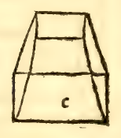
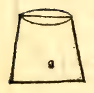

:layout: book

.. _compendio-cap_66-en:

CHAPTER LXVI (English)
======================

.. rubric:: On the Way and Rule to Know How to Measure Every Complete Pyramid, Round or Lateral.

.. container:: track-nav

   **English** · :ref:`Italiano (1509) <compendio-cap_66-it>` · :ref:`Deutsch (1889) <compendio-cap_66-de>` · :ref:`Notes <compendio-cap_66-notes>` | :ref:`Conspectus <compendio-index>` · :ref:`← Prev <compendio-cap_65-en>` · :ref:`Next → <compendio-cap_67-en>`

.. folio:: 0056 (f. 20v)
   :initial: 0056.c1.png

The true and exact measure of every complete pyramid (*pyramide integra*), whether **round** (cone) or **lateral** (polygonal pyramid), is obtained from the volume of its corresponding column in the following universal manner (:just:`XII.7` Corollary, :just:`XII.10`):

.. enunciation:: Universal Rule for the Volume of Any Complete Pyramid or Cone (:just:`XII.7`, :just:`XII.10`)

   First find the area of the base of the pyramid by the rules given above for round and lateral columns (:ref:`Chapters LXII–LXIII <compendio-cap_62-en>`), and multiply that base area by the perpendicular **altitude** (*axe / altezza*) of the pyramid; the product is the solid volume of the entire corresponding **column**. Then take **one-third** (:math:`\frac{1}{3}`) of that column's volume; that third part is **infallibly and exactly** the solid volume (*quantità corporale*) of the pyramid:

   .. math::

      \text{Volume}_{\text{pyramid}} = \frac{1}{3}\,\text{Volume}_{\text{column}} = \frac{1}{3}\,\text{Area}_{\text{base}} \times h

.. assertion:: Worked Example and Euclidean Justification (:just:`XII.10` [Campanus XII.9], :just:`XII.7` [Campanus XII.8])

   1. Let :math:`abc` be a round pyramid (cone) whose circular base :math:`bc` has diameter :math:`7` and whose perpendicular altitude (axis) :math:`ad` is :math:`10` (see the marginal diagram ``0057.g1.png``).
   2. As we found in :ref:`Chapter LXII <compendio-cap_62-en>` for the round column of diameter :math:`7` and altitude :math:`10`, the area of the circular base is :math:`\frac{11}{14} \times 49 = 38\frac{1}{2}`, and multiplying by the altitude :math:`10` gives :math:`385` for the volume of the entire round column.
   3. Taking **one-third** (:math:`\frac{1}{3}`) of :math:`385` gives:

      .. math::

         \frac{385}{3} = 128\frac{1}{3}

      which is the solid volume of the round pyramid!
   4. **Distinction Between the Approximation of the Circle and the Exactness of the One-Third Ratio**:
      Note well, most lofty Duke, that although in the round pyramid the numerical area of the circular base uses :person:`Archimedes <archimedes>`' close ratio of :math:`11` to :math:`14` (because the exact quadrature of the circle is not yet known in numbers), nevertheless **the geometric ratio of the round pyramid to its round column is not an approximation at all, but is with absolute mathematical precision one-third (:math:`\frac{1}{3}`)**! For in the :just:`tenth of the twelfth <XII.10>` (the ninth of the twelfth in :person:`Campanus <campanus>`), our philosopher proves demonstratively that **every round column (cylinder) is triple (:math:`3 : 1`) its round pyramid (cone)** having the same base and equal altitude.
   5. And in all **lateral pyramids**, because their bases are rectilinear polygons whose areas can be expressed without circular quadrature, both the base area and the volume are exact, and by the :just:`seventh of the twelfth <XII.7>` (and the eighth of the twelfth in :person:`Campanus <campanus>`), **every lateral column is exactly triple (:math:`3 : 1`) its lateral pyramid**.

.. qed::

Marginal Woodcut Diagrams (Paganini 1509)
-----------------------------------------

.. figure:: 0056.g1.png
   :align: center

   Folio 0056 Diagram 1

.. figure:: 0056.g2.png
   :align: center

   Folio 0056 Diagram 2

.. figure:: 0056.g3.png
   :align: center

   Folio 0056 Diagram 3

.. figure:: 0056.g4.png
   :align: center

   Folio 0056 Diagram 4

   Folio 0056 Diagram 5

   Folio 0056 Diagram 6

.. figure:: 0056.g7.png
   :align: center

   Folio 0056 Diagram 7
