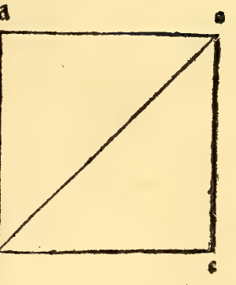
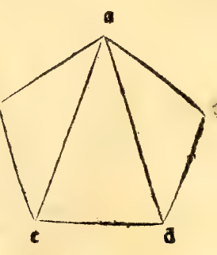

:layout: book

.. _compendio-cap_68-en:

CHAPTER LXVIII (English)
========================

.. rubric:: How Short or Truncated Pyramids (*Pyramidi Corte ouer Scapezze*) Are Measured.

.. container:: track-nav

   **English** · :ref:`Italiano (1509) <compendio-cap_68-it>` · :ref:`Deutsch (1889) <compendio-cap_68-de>` · :ref:`Notes <compendio-cap_68-notes>` | :ref:`Conspectus <compendio-index>` · :ref:`← Prev <compendio-cap_67-en>` · :ref:`Next → <compendio-cap_69-en>`

.. folio:: 0057–0058 (f. 21r–f. 21v)
   :initial: 0057.c1.png

For **short, lopped, or truncated pyramids** (*pyramidi corte, scapezze, ouer troncate*, whether round frusta of cones or lateral frusta of pyramids, :ref:`Plates LVII–LVIII <plates-polyhedra-en>`), their solid measure is found by means of their **complete pyramids**, reducing the imperfect to its perfect whole in the following manner:

.. enunciation:: Rule for Measuring Any Truncated Pyramid or Cone (Frustum)

   1. First **complete the truncated pyramid to its full apex (*cono*)** by the proportional rule given in our published great work (*:cite:`Summa de Arithmetica <pacioli:summa>`*: using the ratio of a side or diameter of the lower base :math:`B_1` to the corresponding side or diameter of the parallel upper cut :math:`B_2` and the height :math:`h_{\text{frustum}}` of the frustum to find the height :math:`h_{\text{top}} = \frac{s_2}{s_1 - s_2}\,h_{\text{frustum}}` of the missing top pyramid, and hence the total height :math:`h_{\text{total}} = h_{\text{frustum}} + h_{\text{top}}` of the completed pyramid).
   2. Second, **measure the entire completed pyramid** (base :math:`B_1` and total height :math:`h_{\text{total}}`) by the rule of :ref:`Chapter LXVI <compendio-cap_66-en>` (:math:`V_{\text{total}} = \frac{1}{3}B_1\,h_{\text{total}}`), and set that total volume aside.
   3. Third, **measure the small upper pyramid (*pyramidella*)** that was added to the top to make it complete (base :math:`B_2` and height :math:`h_{\text{top}}`, giving :math:`V_{\text{top}} = \frac{1}{3}B_2\,h_{\text{top}}`).
   4. Finally, **subtract the volume of the small added pyramid (*pyramidella*) from the volume of the entire completed pyramid**:

      .. math::

         \text{Volume}_{\text{truncated}} = V_{\text{total}} - V_{\text{top}} = \frac{1}{3}\,B_{1}\,h_{\text{total}} - \frac{1}{3}\,B_{2}\,h_{\text{top}}

      The remainder is necessarily the exact solid volume of the truncated pyramid! Among all the methods given by geometers, this way is the shortest and most secure, and holds equally for round and lateral truncated pyramids.

.. qed::

Marginal Woodcut Diagrams (Paganini 1509)
-----------------------------------------

   Folio 0057 Diagram 1

   Folio 0057 Diagram 2
