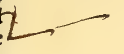

:layout: book

.. _compendio-cap_70-de:

CAPITEL LXX (Deutsch — Winterberg 1889)
=======================================

.. rubric:: Wie alle besagten Körper, wie sie in diesem Tractate aufge- stellt und in Perspective gesetzt sind, und auch ihre materiellen Formen nach ihrer der Oeffentlichkeit übergebenen speciellen Tabelle der Reihe nach aufzufinden seien.

.. container:: track-nav

   :ref:`English <compendio-cap_70-en>` · :ref:`Italiano (1509) <compendio-cap_70-it>` · **Deutsch (1889)** · :ref:`Notes <compendio-cap_70-notes>` | :ref:`Conspectus <compendio-index>` · :ref:`← Prev <compendio-cap_69-de>` · :ref:`Next → <compendio-cap_71-de>`

.. folio:: 0059 (f. 22r)
   :initial: 0059.c1.png

Weil da, wo keine Ordnung ist, stets Gonfusion stattfindet, so wird Euer Hoheit zur vollständigen Einsicht in dieses unser Gompendium, um alle besonderen in diesem Werke zu perspectivischer Anschauung gebrachten Figuren und auch die materiellen nach der von ihnen publicirten Tabelle auffinden zu können, folgendes Verfahren beobachten, nämlich wenn ihr oben in ihren Gapiteln über ihre Herstellung und Bildung lesen werdet, so werdet ihr an Jener Stelle die mit antikem Abucus bezeichnete Zahl des Buches merken, d. h. so beginnend vom ersten bis 48. Gapitel, I. II. III. IV. V u. s. f. bis an ihr Ende bezeichnet. Und genau dieselbe Zahl werdet ihr vorn aufsuchen, wo in diesen Werken die genannten Körper der Reihe nach sämmtlich abgebildet sind. Und diese Zahl wird gleicherweise an Jenem Orte angegeben sein, indem sich I auf I, II auf II, III auf III bezieht, und ebenso bei allen übrigen. Und Jene Figur wird die des besagten Körpers sein, der mit aller Vollkommenheit der Perspective auf die Ebene projicirt, wie es unser Leonardo Vinci versteht. Und eben dieselben Zahlen werdet ihr ferner unter den materiellen Formen besagter Körper aufsuchen, die

in einem Brevet hängen, zugleich mit ihren im Griechischen und Lateinischen gesetzten Namen, der über jedem an seiner Schnur zwischen zwei schwarzen Bernsteinstiften befestigt, indem sich auch da jeder, wie gesagt, auf die dabei gesetzte Zahl bezieht, wo über denselben gehandelt wird, und Euer Hoheit haben auf beide Weise ihre Anordnung. Dieselben verdienten nicht aus schlechtem Stoffe (wie es für mich aus Mangel nothwendig gewesen), sondern aus kostbarem Metall und mit feinen Edelsteinen geschmückt zu sein. Aber Euer Hoheit wird die Liebe und die Gesinnung in Ihrem beständigen Sklaven berücksichtigen.

Marginal Woodcut Diagrams (Paganini 1509)
-----------------------------------------

   Folio 0059 Diagram 1
