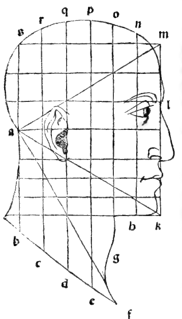

:layout: book
:canonical_id: Arch. Cap. I
:folio: 0065–0067 (f. 25r–f. 26r)

.. _architectura-cap_01:
.. _architectura-cap_01-en:

CHAPTER I
=========

.. rubric:: On the Measure and Proportions of the Human Body, of the Head, and of Its Other Members as the Model and Simulacrum of Architecture.

.. folio:: 0065–0067 (f. 25r–f. 26r)
   :initial: 0065.c1.png

We must first consider, as :person:`**Plato** <plato>` says in his :cite:`*Timaeus* <plato:timaeus:53c-56c>` when treating of the nature of the universe, that when God fashioned man, He placed the **head** at the highest summit of the body in the likeness of the **citadels and fortresses** (*rocche e fortezze*) in cities, so that it might stand as the watchtower and guardian of the entire bodily edifice and all its lower members.

.. rubric:: 1. The Head as the Citadel of the Body and the Five Senses

And Nature armed and fortified this citadel of the head with **seven embrasures or loopholes** (*7 balestriere, cioè 7 busi*) through which the intellect might apprehend exterior things—namely the **two ears**, the **two eyes**, the **two nostrils** of the nose, and the **seventh, the mouth**—because, as the philosophical maxim declares:

   *Nihil est in intellectu quin prius sit in sensu* ("There is nothing in the intellect that was not first in the five senses": sight, hearing, smell, touch, and taste).

Hence arises the Latin proverb: *Quando caput dolet, cetera membra languent* ("When the head aches, all the other members languish")—just like the citadels of cities when they are besieged and battered by enemies with military engines of artillery: **trebuchets (*briccole, trabocchi*), catapults (*catapulte*), ballistas (*baliste*), bombards (*bombarde*), passevolants (*passavolanti*), hand-guns (*schioppetti*), arquebuses (*archibusi*), curtalds (*cortaldi*), basilisks (*basilischi*)**, and other destructive ordinance, whereby the whole city suffers in dread of its survival!

Therefore Nature, minister of the Divinity, in forming man disposed his head and body with all due proportions corresponding to one another; and the Ancients, observing this disposition of the human body, proportioned all their architectural works—above all **sacred temples**—after its likeness, because in the human body they found the **two most principal geometric figures**, without which nothing can be wrought:

1. The **Circle** (*la circolare*), most perfect and of all figures having equal perimeter the most capacious (*isoperimetrarum capacissima*, as :person:`Dionysius <dionysius>`/Zenodorus proves in *De sphaeris*), generated by the **curved line**;
2. The **Equilateral Square** (*la quadrata equilatera*), generated by the **straight line**.

.. rubric:: The Vitruvian Man in the Circle and the Square (Vitruvius III.1.3)

.. assertion::

   1. **The Circle in the Human Body**: If a man lies supine on his back and spreads out his arms and legs as wide as possible, his **navel** (*el bellico*) is the exact **center** of the whole figure: fixing one end of a cord at the navel and sweeping the other end around, it touches equally the crown of the head (*la summita del capo*), the tips of the middle fingers of the outstretched hands, and the tips of the great toes of the feet—fulfilling the exact definition of the circle given by our :person:`**Euclid** <euclid>` at the beginning of his first book (:just:`I.Def.15`)!
   2. **The Square in the Human Body**: Similarly, with the arms stretched straight out horizontally to the sides and the feet standing together, drawing straight lines from the soles of the feet to the tips of the outstretched middle fingers and across from hand to hand and from head to foot forms an **equilateral square**, because the span of a well-formed man's outstretched arms from middle fingertip to middle fingertip is **exactly equal to his height** from the soles of his feet to the crown of his head!

.. rubric:: Construction of the Human Head in the Equilateral Triangle and Thirds (:just:`I.1`)

.. assertion::

   Furthermore, if we examine man's noblest exterior member—the **head**—we find its profile formed upon the **very first rectilinear figure** placed by our :person:`**Euclid** <euclid>` as the foundation and first proposition of his first book (:just:`I.1`: *Triangulum aequilaterum supra datam lineam rectam collocare*, "To construct an equilateral triangle upon a given finite straight line"), as your eye clearly sees in the marginal diagrams ``0066.g1.png`` and ``0066.g2.png`` on Folio 0066 and in the full-page plate :ref:`Folio 0137 (Divina Proportio) <plates-architectural-en>`:

   1. Let :math:`amk` be an **equilateral triangle** (:g:`isopleuron`), upon whose vertical side :math:`mk` (representing the front profile of the face from the hairline :math:`m` to the bottom of the chin :math:`k`) is constructed the oblong rectangle (:term:`*tetragono longo* <tetragono-longo>`) :math:`kmsb`, whose width :math:`ms = kb` equals the perpendicular altitude (:term:`*catheto* <catheto>`) drawn from the back vertex :math:`a` (at the nape of the neck, *el cotozzo*) to the front profile line :math:`mk`.
   2. The vertical profile line :math:`mk` is divided into **three equal parts** (thirds):

      - **First Third (Forehead)**: From the hairline at the top of the forehead (:math:`m`) down to the brow and root of the nose equals **one-third** (:math:`\frac{1}{3}mk`).
      - **Second Third (Nose)**: From the root of the nose down to the bottom of the nostrils (:math:`l`) equals the **second third** (:math:`\frac{1}{3}mk`).
      - **Third Third (Lower Face)**: From the bottom of the nostrils (:math:`l`) down to the bottom plane of the chin (:math:`k`) equals the **final third** (:math:`\frac{1}{3}mk`).

   3. This lowest third (:math:`lk`) is again subdivided into **three equal parts** (each equal to **one-ninth**, :math:`\frac{1}{9}mk`, of the whole facial profile):

      - From the nostrils (:math:`l`) to the slit of the mouth: :math:`\frac{1}{9}mk`;
      - From the mouth to the hollow crease of the chin: :math:`\frac{1}{9}mk`;
      - From the hollow of the chin to the bottom tip of the chin (:math:`k`): :math:`\frac{1}{9}mk`.

   4. Meanwhile, the perpendicular altitude (:term:`*catheto* <catheto>`) from the nape :math:`a` bisects the facial profile :math:`mk` at its exact midpoint and passes straight through the **bridge/prominence of the nose** (*la tomba del naso*).

.. rubric:: 2. Rational vs. Irrational Proportions, Visual Grace (*Gratia*), and the Abstractness of Mathematical Entities

Observe, however, that the curve of the chin recedes slightly inward from the straight vertical line :math:`mk`, and the hairline near :math:`m` likewise curves slightly inward—for otherwise the face would look rigid and lack visual grace (*non haverebe gratia a l'ochio*)! The exact measure of these subtle recesses cannot be expressed by any rational number (*non è possibile a nominare per numero*), for they belong to the **irrational proportions** which Nature has reserved to the **grace and judgment of the eye** (*ala gratia e arbitrio de l'ochio*) of the worthy painter and perspectivist.

For **art imitates nature as far as it is able** (*l'arte imita la natura quanto li sia possibile*): if human artifice could reproduce with absolute identity everything that Nature makes, it would no longer be called *art*, but *a second Nature* identical to the first! And this is why the sages declare that the mathematical sciences are **abstract from matter** (*abstracte dala materia*): no human hand with pen or chisel can ever form a true mathematical point, line, or surface. For although we call that visible mark made by the tip of a pen or stylus a "point," it is not the true mathematical point defined by our :person:`Euclid <euclid>` in the very first words of his *Elements* (:just:`I.Def.1`): *Punctus est cuius pars non est* ("A point is that which has no part")—we merely use the names *point*, *line*, and *surface* for visible signs because we lack other words to express those pure intellectual concepts.

.. qed::

Marginal Woodcut Diagrams (Paganini 1509)
-----------------------------------------

   Folio 0066 Diagram 1
