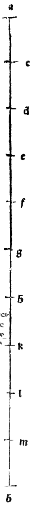

:layout: book
:canonical_id: Arch. Cap. III
:folio: 0068–0069 (f. 26v–f. 27r)

.. _architectura-cap_03:
.. _architectura-cap_03-en:

CHAPTER III
===========

.. rubric:: On the Proportion of the Whole Well-Disposed Human Body to Its Head and Other Members According to Length and Breadth, and on the Perfect Numbers Six, Ten, and Sixteen.

.. folio:: 0068–0069 (f. 26v–f. 27r)
   :initial: 0068.c1.png

Having treated sufficiently of the proportions of the head, we now set forth the proportions of the **entire human body** to its head and other exterior members—measured always on the **bare bone stripped of flesh** (*del puro osso netto dale carni*), since some men are corpulent and others lean, whereas the skeleton is firm and invariable—so that after this canon you may proportion your columns and buildings.

.. rubric:: Vitruvian Canon of the Human Body (Vitruvius III.1.2)

.. assertion::

   With the Ancients and our :person:`**Vitruvius** <vitruvius>` (Book III, Chapter 1, *De sacrarum aedium compositione*), we state the following fundamental ratios of the total stature (height) of a well-proportioned man from the soles of his feet to the crown of his head:

   1. **The Face (*Testa / Os Capitis*, :math:`= \frac{1}{10}`)**: From the bottom of the chin to the top of the forehead at the roots of the hair (our profile line :math:`mk` in :ref:`Chapter I <architectura-cap_01-en>`) is **one-tenth** (:math:`\frac{1}{10}`) of the total height of the body.
   2. **The Hand (*Palma dela Mano*, :math:`= \frac{1}{10}`)**: From the wrist joint (*articolo*) to the tip of the middle finger is likewise **one-tenth** (:math:`\frac{1}{10}`) of the total height (equal to one face, *vna testa*).
   3. **The Whole Head (*Tutto el Capo*, :math:`= \frac{1}{8}`)**: From the bottom of the chin to the highest crown (*vertice*, point :math:`p`) of the skull is **one-eighth** (:math:`\frac{1}{8}`) of the total height.
   4. **From the Top of the Chest to the Hairline (:math:`= \frac{1}{6}`)**: Equals **one-sixth** (:math:`\frac{1}{6}`) of the total height.
   5. **From the Top of the Chest to the Crown of the Head (:math:`= \frac{1}{4}`)**: Equals **one-fourth** (:math:`\frac{1}{4}`) of the total height.
   6. **Subdivisions of the Face (:math:`= \frac{1}{3}` of :math:`\frac{1}{10}` each)**: From the chin to the nostrils is :math:`\frac{1}{3}` of the face; the nose from the nostrils to the brow is :math:`\frac{1}{3}`; and the forehead from the brow to the hairline is :math:`\frac{1}{3}`.
   7. **The Foot (*El Pede*, :math:`= \frac{1}{6}`)**: From the heel to the tip of the great toe is **one-sixth** (:math:`\frac{1}{6}`) of the total height.
   8. **The Cubit / Forearm (*El Cubito*, :math:`= \frac{1}{4}`)**: Equals **one-fourth** (:math:`\frac{1}{4}`) of the total height.
   9. **The Chest / Breast (*El Petto*, :math:`= \frac{1}{4}`)**: Equals **one-fourth** (:math:`\frac{1}{4}`) of the total height.

   As :person:`Vitruvius <vitruvius>` himself writes verbatim in Latin (III.1.2):

      *Corpus enim hominis ita natura composuit, uti os capitis a mento ad frontem summam et radices imas capilli esset decimae partis; item manus palma ab articulo ad extremum medium digitum tantundem; caput a mento ad summum verticem octavae... Pes vero altitudinis corporis sextae, cubitusque quartae, pectus item quartae. Reliqua quoque membra suos habent commensus proportionis, quibus etiam antiqui pictores et statuarii nobiles usi magnas et infinitas laudes sunt assecuti. Similiter vero sacrorum aedificiorum membra ad universam totius magnitudinis summam ex partibus singulis convenientissimum debent habere commensum responsum.*

.. rubric:: The Perfect Numbers Ten, Six, and Sixteen (Vitruvius III.1.5–8 & Euclid :just:`IX.36`)

.. assertion::

   1. **The Philosophical Perfect Number Ten (*Denario / Teleon*)**:
      Those who divide the human body into **10 parts** follow the natural philosophers and :person:`**Plato** <plato>`, calling **10** the *perfect number* (Greek :g:`teleion`) both because all things fall under :person:`Aristotle <aristotle>`'s **10 Categories** (*X Predicamenti*: *quoniam numero denario omnes philosophi sunt contenti*) and because Nature formed **10 fingers** on the hands and **10 toes** on the feet from individual units (*monades*).
   2. **The Mathematical Perfect Number Six (:just:`IX.36`)**:
      Mathematicians, however, call a number **perfect** when it is equal to the sum of all its proper aliquot parts (divisors)—of which the first is **6** (:math:`= 1 + 2 + 3`, matching the 6 feet of a man's height!) and the second is **28** (:math:`= 1 + 2 + 4 + 7 + 14`), as we explained in our great work (*Summa*, Dist. I, Tract. 2) and as our :person:`**Euclid** <euclid>` proves in the :just:`last proposition of the ninth book <IX.36>`:

      .. math::

         \text{If } S = 1 + 2 + 4 + \dots + 2^{n-1} \text{ is prime, then } 2^{n-1}\,S \text{ is a Perfect Number.}

      (*Cum coaptati fuerint numeri ab unitate continue dupli qui coniuncti faciant numerum primum, extremus eorum in aggregatum ex eis ductus producit numerum perfectum.*)

   3. **The Most Perfect Number Sixteen (:math:`10 + 6 = 16`, and :math:`4^{2} = (2^{2})^{2}`)**:
      Joining together the philosophical perfect number **10** and the mathematical perfect number **6** produces **16** (:math:`10 + 6 = 16`, the 16 digits in a foot!), which :person:`Vitruvius <vitruvius>` calls the **most perfect number** (*perfectissimo*). And proceeding mathematically, we may add a second reason of our own (*ratione quadraturae*): **16** is the **square of the first square** (*el quadrato del primo quadrato*, or :term:`*censo de censo* <censo-de-censo>` in algebra!), since setting aside unity (the queen of all numbers), the first square (*censo primo*) is **4** (:math:`= 2^{2}`), and its square is **16** (:math:`= 4^{2} = 2^{4}`)!

To keep all these human proportions before your eyes at a single opening of the compass, I have placed in the margin on Folio 0069 (diagram ``0069.g1.png``) the graduated scale line :math:`ab` divided into 10 equal parts at points :math:`c, d, e, f, g, h, k, l, m`, by which you can scale any figure—whether life-sized, a giant (*gigante*), or a dwarf (*nanino*)—just as cosmographers use their degree-scales on world maps (*mappamondi*) and nautical charts (*carte naviganti*).

.. qed::

Marginal Woodcut Diagrams (Paganini 1509)
-----------------------------------------

   Folio 0069 Diagram 1
