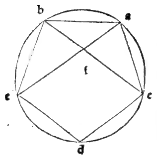

:layout: book
:canonical_id: Cap. XVII
:folio: 0028 (f. 6v)

.. _compendio-cap_17-de:

CAPITEL XVII
============

.. rubric:: Von der umgekehrten Wirkung der vorhergehenden.

.. folio:: 0028 (f. 6v)
   :initial: 0028.c2.png

Wenn eine Linie nach der Proportion getheilt ist, die einen mittleren und zwei äussere Abschnitte hat, so ist immer in dem Kreise wofüF der grössere Abschnitt die Seite des ihm einbeschriebenen Sechseckes ist, der kleinere die entsprechende Zehnecksseite. Wenn z. B. die getheilte Linie zehn wäre, so wird der grössere Abschnitt, welcher ]/"i25 — 5, immer die Seite des Sechseckes eines Kreises sein, dessen Durchmesser das Doppelte von √125 − 5, nämlich i/'doo — lo sein wird.

Ich behaupte, dass in demselben Kreise der kleinere Abschnitt i5 — \/i25 die Seite des demselben einbeschriebenen gleichseitigen Zehneckes sei. Und dieser Umkehrung bedient sich häufig Ptolomäus im neunten Capitel des ersten Lehrsatzes seines :cite:`Almagest <ptolemy:almagest:I.9>`'s, um die Grosse der Sehnen von Kreisbögen nachzuweisen. Wie gleichfalls in der vorgenannten neunten des 1 3 geometrisch klar bewiesen wird.

Marginal Woodcut Diagrams (Paganini 1509)
-----------------------------------------

   Folio 0028 Diagram 1
