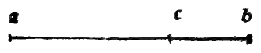

:layout: book
:canonical_id: Cap. XX
:folio: 0029 (f. 7r)

.. _compendio-cap_20-de:

CAPITEL XX
==========

.. rubric:: Von ihrer 11. ausgezeichnetsten Wirkung.

.. folio:: 0029 (f. 7r)
   :initial: 0029.c2.png

Wenn man die Seite eines gleichseitigen Sechsecks nach unserer :term:`göttlichen Proportion <divina-proportione>` theilen wird, so wird ihr grösserer Abschnitt stets nothwendig die Seite des von demselben Kreise wie das Sechseck umschriebenen Zehnecks sein. Wenn z. B. die aut die genannte Art getheiltc Seite des Rechtecks = 10 wäre, so wird ihr grösserer Abschnitt j/ 125— 5 sein, was, behaupte ich, genau die Seite des von demselben Kreise umschriebenen Zehnecks ist, dessen Durchmesser 20 betragen würde. Und dieses wird aus der dritten des vierzehnten geschlossen.

Daher wird augenscheinlich, nachdem man die Seite des einen erhalten, die Seite des andern leicht gefunden und ebenso kann man, nachdem der Durchmesser des Kreises oder sein Umfang oder sein Flächeninhalt oder der irgend eines Theiles von ihm erhalten, stets dadurch zur Kenntniss des einen oder des andern durch das eine gelangen, und ebenso auf alle Arten umgekehrt vom Kreise, Sechseck, Zehneck und auch Dreieck aus durch arithmetische und geometrische Operation — was eine sehr nützliche Sache ist, wie es oben beim neunten Effect bezüglich des Fünfecks gesagt worden. Daher etc.

Marginal Woodcut Diagrams (Paganini 1509)
-----------------------------------------

   Folio 0029 Diagram 1
