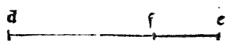

:layout: book
:canonical_id: Cap. XXI
:folio: 0029–0030 (f. 7r–f. 7v)

.. _compendio-cap_21:
.. _compendio-cap_21-en:

CHAPTER XXI
===========

.. rubric:: On Its Twelfth Almost Incomprehensible Effect

.. folio:: 0029–0030 (f. 7r–f. 7v)
   :initial: 0029.c3.png

.. enunciation::

   If a quantity be divided according to our said proportion, the **square root of the sum of the square of the whole quantity and the square of its greater part** will stand in the exact same ratio to the **square root of the sum of the square of the said whole quantity and the square of its lesser part** as the **side of the cube** stands to the **side of the triangle of the twenty-base body [the icosahedron]**, when both bodies are circumscribed by one and the same sphere (:just:`XIV.9`):

   $$\frac{\sqrt{(a + b)^2 + a^2}}{\sqrt{(a + b)^2 + b^2}} = \frac{s_{\text{cube}}}{s_{\text{icosahedron}}}$$

.. rubric:: Numerical Demonstration with Universal Roots (*Radici Legate*)

.. assertion::

   For example, let $10$ be the quantity divided according to the proportion having a mean and two extremes, so that one part—namely the greater ($a$)—is, as has been said many times, $\sqrt{125} - 5$, and the lesser ($b$) is $15 - \sqrt{125}$.

   1. Let the said whole quantity ($10$) be squared—that is, multiplied by itself—which will make $100$.
   2. Let its greater part ($\sqrt{125} - 5$) also be squared, which multiplied by itself will make $150 - \sqrt{12500}$.
   3. And let its lesser part ($15 - \sqrt{125}$) also be squared, which multiplied by itself makes $350 - \sqrt{112500}$.
   4. Now to the square of the greater part ($150 - \sqrt{12500}$) let the square of the whole quantity ($100$) be added, which will make:

      $$(a + b)^2 + a^2 = 250 - \sqrt{12500}$$

   5. And let the same square of the whole quantity ($100$) be added to the square of the lesser part ($350 - \sqrt{112500}$), which will make:

      $$(a + b)^2 + b^2 = 450 - \sqrt{112500}$$

   Now I say that the ratio of the **square root of the first sum**—namely $\sqrt{250 - \sqrt{12500}}$, formed from the square of the whole quantity and the square of the greater part—to the **square root of the second sum**—namely $\sqrt{450 - \sqrt{112500}}$, formed from the square of the whole quantity and the square of its lesser part—is **precisely the ratio of the side of the cube to the side of the triangle of the twenty-base body [icosahedron]**, when both of the said bodies are circumscribed or surrounded by one and the same sphere!

   These roots of sums [nested radicals] are called in geometry **lines having power over the said sums** (*linee potenti sopra dicti congionti*): that is, $\sqrt{250 - \sqrt{12500}}$ means a line whose *power* or square is equal to that exact sum ($250 - \sqrt{12500}$); and similarly $\sqrt{450 - \sqrt{112500}}$ means a quantity whose power or square is equal to $450 - \sqrt{112500}$.

   By practicing algebraists (*pratici*), such roots are called by another name **universal roots** (*radici universali*) or **bound roots** (*radici legate*), as appears in our aforesaid work [:cite:`*Summa de Arithmetica* <pacioli:summa>`], in the Third Treatise of its Eighth Distinction, beginning at folio 120 of the said volume. These quantities belong to the most subtle investigation and pertain to speculative practice (*pratica speculativa*), as is shown at length in that volume; and, Most Exalted Prince, it is impossible to express them in any simpler or lower terms (*con più depresse denotationi*).

.. qed::

   And this entire speculative effect is demonstrated geometrically by the ninth proposition of the Fourteenth Book (:cite:`Campanus XIV.9 <campanus:euclid:XIV.9>`), together with several others adduced in that place by :person:`Campanus <campanus>`.

Marginal Woodcut Diagrams (Paganini 1509)
-----------------------------------------

   Folio 0029 Diagram 2
