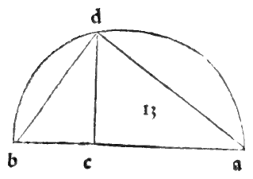

:layout: book
:canonical_id: Cap. XXV
:folio: 0031–0032 (f. 8r–f. 8v)

.. _compendio-cap_25:
.. _compendio-cap_25-en:

CHAPTER XXV
===========

.. rubric:: How It Is Not Possible for There to Be More Than Five Regular Bodies in Nature, and Why.

.. folio:: 0031–0032 (f. 8r–f. 8v)
   :initial: 0031.c2.png

Having seen the sublime and marvelous effects of our :term:`Divine Proportion <divina-proportione>` in plane figures and lines, it now follows, most lofty Duke, to treat of the five regular solid bodies—which, as we said at the outset, are those that have equal sides, equal plane bases (faces), and equal :term:`solid angles <angulo-solido>`, and which, when placed in a sphere, touch its interior surface with all their vertices—and first to demonstrate why in the nature of things there cannot be more than five such bodies (:just:`XIII.18` Scholium; :just:`XI.21`).

.. enunciation:: Uniqueness of the Five Regular Polyhedra

   No solid body bounded by equilateral and equiangular plane figures all equal and similar to one another can be formed beyond the five regular bodies—namely three bounded by equilateral triangles (the :term:`*tetracedron* <tetrahedron>` of four faces, the :term:`*octocedron* <octahedron>` of eight faces, and the :term:`*ycocedron* <icosahedron>` of twenty faces), one bounded by squares (the *cubo* or :term:`*exacedron* <exahedron>` of six faces), and one bounded by regular pentagons (the :term:`*duodecedron* <dodecahedron>` of twelve faces).

.. assertion:: Proof from Solid Angles (:just:`XI.21`, :just:`I.32`)

   1. By the :just:`twenty-first of the eleventh <XI.21>`, every :term:`solid angle <angulo-solido>` is contained by at least three plane angles, and the sum of all the plane angles that meet to form any convex :term:`solid angle <angulo-solido>` must always be **less than four right angles** (:math:`360^{\circ}`). For if the plane angles meeting at a point equaled four right angles, they would lie flat in a single continuous plane surface and could never close to form a solid corner or vertex; and still less can they exceed four right angles.
   2. **First Case — Equilateral Triangles**: By the :just:`thirty-second of the first <I.32>`, the three interior angles of any triangle equal two right angles; hence in an equilateral triangle (:g:`isopleuron`) each angle equals **two-thirds of one right angle** (:math:`\frac{2}{3}R = 60^{\circ}`).

      - If **three** equilateral triangles meet at one point, their three angles equal :math:`3 \times \frac{2}{3}R = 2R` (two right angles, :math:`180^{\circ}`), which is less than four right angles. From such :term:`solid angles <angulo-solido>` of three triangles is formed the **first regular body**, the pyramid of four triangular bases called the :term:`**tetracedron** <tetrahedron>` (:term:`tetrahedron <tetrahedron>`).
      - If **four** equilateral triangles meet at one point, their four angles equal :math:`4 \times \frac{2}{3}R = \frac{8}{3}R = 2\frac{2}{3}R` (:math:`240^{\circ}`), which is less than four right angles. From such :term:`solid angles <angulo-solido>` of four triangles is formed the **third regular body**, of eight triangular bases, called the :term:`**octocedron** <octahedron>` (:term:`octahedron <octahedron>`).
      - If **five** equilateral triangles meet at one point, their five angles equal :math:`5 \times \frac{2}{3}R = \frac{10}{3}R = 3\frac{1}{3}R` (:math:`300^{\circ}`), which is still less than four right angles. From such :term:`solid angles <angulo-solido>` of five triangles is formed the **fourth regular body**, of twenty triangular bases, called the :term:`**ycocedron** <icosahedron>` (:term:`icosahedron <icosahedron>`).
      - If **six** equilateral triangles meet at one point, their six angles equal :math:`6 \times \frac{2}{3}R = 4R` (**four right angles**, :math:`360^{\circ}`). Therefore, by :just:`XI.21`, six equilateral triangles cannot form a :term:`solid angle <angulo-solido>`, nor can seven or more; hence from equilateral triangles **only three** regular bodies can ever be generated.

   3. **Second Case — Squares**: In the equilateral and equiangular quadrangle (the square), each interior angle is **one right angle** (:math:`1R = 90^{\circ}`).

      - If **three** squares meet at one point, their three plane angles equal :math:`3R` (**three right angles**, :math:`270^{\circ}`), which is less than four right angles. From such :term:`solid angles <angulo-solido>` is formed the **second regular body**, of six square bases, called the **cubo** or :term:`**exacedron** <exahedron>` (cube).
      - If **four** squares meet at one point, their angles equal **four right angles** (:math:`360^{\circ}`), forming a flat plane and no :term:`solid angle <angulo-solido>`; hence from squares **only one** regular body can be formed.

   4. **Third Case — Regular Pentagons**: By the :just:`thirty-second of the first <I.32>`, any pentagon is resolved into three triangles, whose angles total :math:`3 \times 2R = 6R` (six right angles); dividing :math:`6R` equally among the five angles of a regular pentagon gives :math:`\frac{6}{5}R = 1\frac{1}{5}R` (:math:`108^{\circ}`) for each pentagonal angle.

      - If **three** regular pentagons meet at one point, their three angles equal :math:`3 \times 1\frac{1}{5}R = 3\frac{3}{5}R` (:math:`324^{\circ}`), which is less than four right angles. From such :term:`solid angles <angulo-solido>` is formed the **fifth and noblest regular body**, of twelve pentagonal bases, called the :term:`**duodecedron** <dodecahedron>` (:term:`dodecahedron <dodecahedron>`).
      - If **four** regular pentagons were to meet at one point, their angles would equal :math:`4 \times 1\frac{1}{5}R = 4\frac{4}{5}R` (:math:`432^{\circ}`), which exceeds four right angles; hence from pentagons **only one** regular body can be formed.

   5. **Fourth Case — Hexagons and Higher Polygons**: An equilateral hexagon is resolved into four triangles (:math:`8R`), so each interior angle equals :math:`\frac{8}{6}R = 1\frac{1}{3}R` (:math:`120^{\circ}`). Even the minimum number of three hexagons meeting at a point produces :math:`3 \times 1\frac{1}{3}R = 4R` (**four right angles**, :math:`360^{\circ}`), which cannot form a :term:`solid angle <angulo-solido>`. And in heptagons, octagons, and all polygons of more sides, three angles always exceed four right angles.

Therefore, in the entire universe of nature, there can be neither more nor fewer than **five** regular solid bodies.

.. qed::

Marginal Woodcut Diagrams (Paganini 1509)
-----------------------------------------

   Folio 0032 Diagram 1
