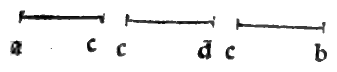

:layout: book
:canonical_id: Cap. XXVI
:folio: 0032 (f. 8v)

.. _compendio-cap_26:
.. _compendio-cap_26-en:

CHAPTER XXVI
============

.. rubric:: How the First Regular Body, Called the Tetracedron or Pyramid of Four Triangular Bases, Is Formed and Placed in the Sphere.

.. folio:: 0032 (f. 8v)

Now that we have shown why there cannot be more than five regular bodies, we shall explain in order how each of them is formed from the given diameter of the sphere in which it is to be inscribed, beginning with the first, called the :term:`**tetracedron** <tetrahedron>` (:just:`XIII.13`).

.. enunciation:: Construction of the Regular Tetrahedron in a Given Sphere (:just:`XIII.13`)

   Given the diameter of a sphere, to find the side of the regular pyramid of four equilateral triangular bases (:term:`*tetracedron* <tetrahedron>`) inscribed in that sphere, and to show that the square on the diameter of the sphere is :term:`sesquialtera <sexquialtera>` (:math:`3 : 2`) to the square on the side of the :term:`tetracedron <tetrahedron>`.

.. rubric:: Construction and Proof (:just:`XIII.13`, :just:`VI.8`, :just:`III.31`, :just:`XIII.12`, :just:`XI.4`)

.. assertion::

   1. Let :math:`ab` be the given diameter of the sphere (see the marginal diagram ``0032.g1.png`` on Folio 0032). Divide :math:`ab` at point :math:`c` so that :math:`ac` is double :math:`cb` (:math:`ac = 2\,cb`), whence :math:`ab` is triple :math:`cb` (:math:`ac = \frac{2}{3}ab`, :math:`cb = \frac{1}{3}ab`).
   2. Upon the diameter :math:`ab` describe the semicircle :math:`adb`, and from point :math:`c` erect the perpendicular :math:`cd` meeting the circumference at :math:`d`, and join the straight lines :math:`da` and :math:`db`.
   3. Because :math:`\angle adb` in a semicircle is a right angle (:just:`III.31`) and :math:`dc` is perpendicular to the base :math:`ab`, by the :just:`eighth of the sixth <VI.8>` the triangles :math:`adb`, :math:`adc`, and :math:`dcb` are similar, and :math:`ac : cd = cd : cb`, so :math:`cd^{2} = ac \cdot cb`. Moreover, :math:`ab : ac = da^{2} : ac^{2} \implies da^{2} = ab \cdot ac`.
   4. Since :math:`ab : ac = 3 : 2` (the :term:`*sesquialtera* <sexquialtera>` ratio), the square on the diameter of the sphere (:math:`ab^{2}`) has to the square on the chord :math:`da` (:math:`da^{2}`) the ratio :math:`3 : 2` (:math:`da^{2} = \frac{2}{3}ab^{2}`), and :math:`da^{2} : cd^{2} = ac : cb = 2 : 1`.
   5. Now construct in a plane a circle whose radius (semidiameter) equals :math:`cd`, and inscribe in it the equilateral triangle :math:`efg`. By the :just:`twelfth of the thirteenth <XIII.12>`, the square on the side of an equilateral triangle inscribed in a circle is triple the square on the radius of that circle (:math:`ef^{2} = 3\,cd^{2}`).
   6. Because :math:`ac = 2\,cb`, we have :math:`da^{2} = ac^{2} + cd^{2} = 4\,cb^{2} + cd^{2}`; and since :math:`cd^{2} = ac \cdot cb = 2\,cb^{2}`, it follows that :math:`da^{2} = 2\,cd^{2} + cd^{2} = 3\,cd^{2}`. Therefore :math:`da^{2} = ef^{2}`, so each side :math:`ef, fg, ge` of the equilateral base equals :math:`da`!
   7. Erect from the center :math:`h` of the circle :math:`efg` a perpendicular to the plane of the triangle (:just:`XI.12`) of length :math:`hk = ac`, and join the vertex :math:`k` to :math:`e, f, g`. By the :just:`fourth of the eleventh <XI.4>` and the :just:`penultimate of the first <I.47>`, each slant edge satisfies:

      .. math::

         ke^{2} = kh^{2} + he^{2} = ac^{2} + cd^{2} = da^{2}

      Thus all six edges :math:`ef, fg, ge, ke, kf, kg` are mutually equal to :math:`da`, and as the semicircle :math:`adb` revolves around the fixed axis :math:`ab`, its circumference passes simultaneously through all four vertices :math:`k, e, f, g`.

Therefore the regular :term:`tetracedron <tetrahedron>` has been formed and inscribed in the given sphere, and the square on the sphere's diameter :math:`ab` is :term:`*sesquialtera* <sexquialtera>` (:math:`3 : 2`, or :math:`1\frac{1}{2}`) to the square on the edge :math:`da` of the :term:`tetracedron <tetrahedron>`. For example, if the diameter of the sphere is :math:`6` (so its square is :math:`36`), the square on the side of the :term:`tetracedron <tetrahedron>` is :math:`24`, and the side itself is :math:`\sqrt{24}` (*radice de 24*).

.. qed::

Marginal Woodcut Diagrams (Paganini 1509)
-----------------------------------------

   Folio 0032 Diagram 2
