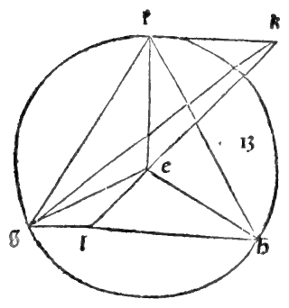
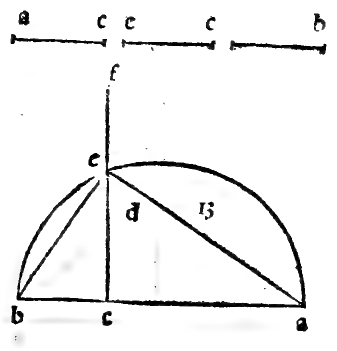
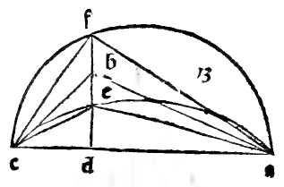

:layout: book
:canonical_id: Cap. XXVII
:folio: 0032–0033 (f. 8v–f. 9r)

.. _compendio-cap_27:
.. _compendio-cap_27-en:

CHAPTER XXVII
=============

.. rubric:: How the Second Regular Body, Called the Exacedron or Cube, Is Formed and Placed in the Sphere.

.. folio:: 0032–0033 (f. 8v–f. 9r)
   :initial: 0032.c1.png

Following the order of :person:`Campanus <campanus>` in the thirteenth book (where the cube is placed as the fourteenth proposition, :just:`XIII.15` in the Greek text), we now show how to form the second regular body, called the **cubo** or :term:`**exacedron** <exahedron>`, which has six square faces, eight :term:`solid angles <angulo-solido>`, and twelve equal edges (:just:`XIII.15`).

.. enunciation:: Construction of the Cube in a Given Sphere (:just:`XIII.15` [Campanus XIII.14])

   Given the diameter of a sphere, to find the side of the cube inscribed in it, and to show that the square on the diameter of the sphere is triple (:math:`3 : 1`) the square on the side of the cube.

.. rubric:: Construction and Proof (:just:`XIII.15`, :just:`VI.8`, :just:`III.31`, :just:`I.47`, :just:`XI.6`, :just:`XI.33`)

.. assertion::

   1. Let :math:`ab` be the diameter of the given sphere (see the marginal diagram ``0033.g1.png`` on Folio 0033), and divide :math:`ab` at point :math:`c` so that :math:`ac` is double :math:`cb` (:math:`ac = 2\,cb`, hence :math:`ab = 3\,cb`).
   2. Describe the semicircle :math:`adb` on diameter :math:`ab`, draw :math:`cd` perpendicular to :math:`ab` meeting the arc at :math:`d`, and join :math:`db` and :math:`da`.
   3. By the :just:`thirty-first of the third <III.31>` and the :just:`eighth of the sixth <VI.8>`, in the right triangle :math:`adb`, :math:`ab : cb = db^{2} : cb^{2}` and :math:`ab : db = db : cb`, so :math:`db^{2} = ab \cdot cb`. Since :math:`ab = 3\,cb`, the square on :math:`ab` is triple the square on :math:`db`:

      .. math::

         ab^{2} = 3\,db^{2}

   4. Now construct a cube whose side (edge) equals :math:`db`: form the square base :math:`efgh` with each side equal to :math:`db`, erect four perpendiculars :math:`ek, fl, gm, hn` of length :math:`db` from the four corners of the base (:just:`XI.12`), which are parallel to one another (:just:`XI.6`), and join their upper extremities to complete the six square faces.
   5. Draw the diagonal :math:`eg` of the base square :math:`efgh`, and join the space diagonal :math:`en` from the lower corner :math:`e` to the opposite upper corner :math:`n`.
   6. Because :math:`efgh` is a square of side :math:`db`, by the :just:`penultimate of the first <I.47>` the square on the face diagonal :math:`eg` is double the square on the edge (:math:`eg^{2} = ef^{2} + fg^{2} = 2\,db^{2}`).
   7. And because the vertical edge :math:`gn` is perpendicular to the base plane, :math:`\angle egn` is a right angle (:just:`XI.Def.3`); hence in the right triangle :math:`egn`, the square on the space diagonal :math:`en` equals :math:`eg^{2} + gn^{2} = 2\,db^{2} + db^{2} = 3\,db^{2}`.
   8. Since we already proved in Step 3 that :math:`ab^{2} = 3\,db^{2}`, it follows that :math:`en^{2} = ab^{2}`, and therefore the space diagonal :math:`en` of the cube equals the diameter :math:`ab` of the sphere!
   9. If a semicircle is described on the space diagonal :math:`en` as diameter and revolved around :math:`en`, by the :just:`thirty-first of the third <III.31>` the semicircle passes through :math:`g` and through every one of the eight right-angled vertices of the cube.

Thus the cube has been constructed and inscribed in the given sphere, and the square on the sphere's diameter is **triple** (:math:`3 : 1`) the square on the edge of the cube. For example, if the diameter of the sphere is :math:`6` (whose square is :math:`36`), the square on the side of the cube is one-third of :math:`36`, namely :math:`12`, and the side of the cube in length is :math:`\sqrt{12}` (*radice de 12*), while the face diagonal is :math:`\sqrt{24}` (equal to the edge of the :term:`tetracedron <tetrahedron>` in the same sphere!).

.. qed::

Marginal Woodcut Diagrams (Paganini 1509)
-----------------------------------------

   Folio 0032 Diagram 3

   Folio 0033 Diagram 1

   Folio 0033 Diagram 2
