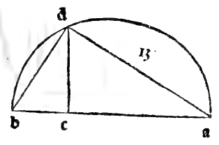
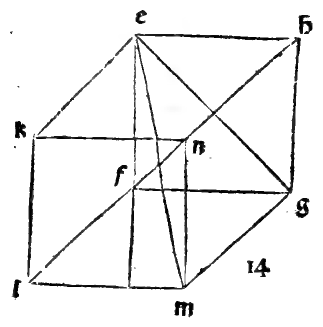
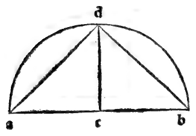

:layout: book
:canonical_id: Cap. XXVIII
:folio: 0033–0034 (f. 9r–f. 9v)

.. _compendio-cap_28:
.. _compendio-cap_28-en:

CHAPTER XXVIII
==============

.. rubric:: How the Third Regular Body, Called the Octocedron of Eight Triangular Bases, Is Formed in the Sphere.

.. folio:: 0033–0034 (f. 9r–f. 9v)
   :initial: 0033.c1.png

Next we show how to form the third regular body, called the :term:`**octocedron** <octahedron>`, which is bounded by eight equilateral triangles meeting four by four at six :term:`solid angles <angulo-solido>` along twelve equal edges (:just:`XIII.14` [:cite:`Campanus XIII.15 <campanus:euclid:XIII.15>`]).

.. enunciation:: Construction of the Regular Octahedron in a Given Sphere (:just:`XIII.14`)

   Given the diameter of a sphere, to find the side of the regular body of eight equilateral triangular bases (:term:`*octocedron* <octahedron>`) inscribed in it, and to show that the square on the diameter of the sphere is double (:math:`2 : 1`) the square on the side of the :term:`octocedron <octahedron>`.

.. rubric:: Construction and Proof (:just:`XIII.14`, :just:`III.31`, :just:`I.47`, :just:`IV.6`)

.. assertion::

   1. Let :math:`ab` be the diameter of the given sphere (see the marginal diagram ``0033.g2.png`` on Folio 0033), and bisect :math:`ab` at its midpoint :math:`c` (:math:`ac = cb = \frac{1}{2}ab`).
   2. Describe the semicircle :math:`adb` upon diameter :math:`ab`, draw :math:`cd` from the center :math:`c` perpendicular to :math:`ab` meeting the circumference at :math:`d`, and join the chord :math:`db` (and :math:`da`).
   3. Because :math:`ac = cb = cd` (all three being radii of the semicircle :math:`adb`), in the right triangle :math:`dcb` (:just:`I.47`), :math:`db^{2} = dc^{2} + cb^{2} = 2\,cb^{2}`. Meanwhile :math:`ab = 2\,cb \implies ab^{2} = 4\,cb^{2}`. Therefore the square on the diameter of the sphere (:math:`ab^{2}`) is **double** the square on :math:`db`:

      .. math::

         ab^{2} = 2\,db^{2}

   4. Now construct in a plane a square :math:`efgh` whose four sides :math:`ef, fg, gh, he` each equal :math:`db` (or equivalently, inscribe the square :math:`efgh` in a circle of diameter :math:`ab` by the :just:`sixth of the fourth <IV.6>`), and draw its two diagonals :math:`eg` and :math:`fh` intersecting at center :math:`k`.
   5. Because :math:`ef = db` and :math:`ab^{2} = 2\,db^{2}`, each diagonal :math:`eg` and :math:`fh` of the square :math:`efgh` equals :math:`ab`, and each half-diagonal :math:`ke, kf, kg, kh` equals the radius :math:`cb = cd` of the sphere.
   6. Through the center :math:`k` of the square :math:`efgh`, draw a straight line :math:`lm` perpendicular to the plane of the square :math:`efgh` on both sides (:just:`XI.12`), making each half-axis :math:`kl` and :math:`km` equal to :math:`ke = kf = kg = kh = cb` (the radius of the sphere).
   7. Join the upper pole :math:`l` and the lower pole :math:`m` by eight straight lines :math:`le, lf, lg, lh` and :math:`me, mf, mg, mh` to the four corners of the central square :math:`efgh`.
   8. Since :math:`kl` and :math:`km` are perpendicular to the plane :math:`efgh`, all eight triangles :math:`kle, klf, \dots, kmh` are right-angled at :math:`k` with legs equal to :math:`cb`; hence by :just:`I.47` each of the eight slant edges equals :math:`db`, matching the four edges :math:`ef, fg, gh, he` of the equatorial square.
   9. Thus all twelve edges are equal to :math:`db`, all eight faces are equilateral triangles, and since the six distances :math:`ke, kf, kg, kh, kl, km` from the center :math:`k` are all equal to the radius :math:`cb` of the sphere, the semicircle described on the axis :math:`lm` passes through all six vertices :math:`l, m, e, f, g, h` as it revolves.

Therefore the :term:`octocedron <octahedron>` is formed and inscribed in the sphere, and the square on the diameter of the sphere is **double** (:math:`2 : 1`) the square on the edge of the :term:`octocedron <octahedron>`. In numbers, if the diameter of the sphere is :math:`6` (whose square is :math:`36`), the square on the edge of the :term:`octocedron <octahedron>` is half of :math:`36`, namely :math:`18`, and its edge in length is :math:`\sqrt{18}` (*radice de 18*).

.. qed::

Marginal Woodcut Diagrams (Paganini 1509)
-----------------------------------------

   Folio 0033 Diagram 3

   Folio 0033 Diagram 4

   Folio 0034 Diagram 1
