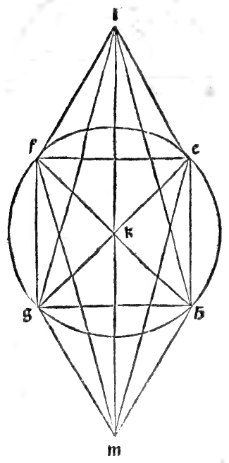
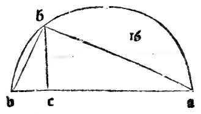
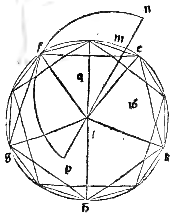
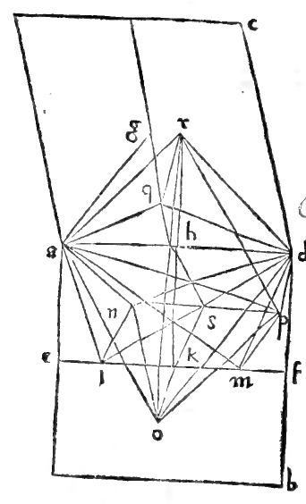

:layout: book
:canonical_id: Cap. XXIX
:folio: 0034–0036 (f. 9v–f. 10v)

.. _compendio-cap_29:
.. _compendio-cap_29-en:

CHAPTER XXIX
============

.. rubric:: How the Fourth Regular Body, Called the Ycocedron of Twenty Triangular Bases, Is Formed in the Sphere.

.. folio:: 0034–0036 (f. 9v–f. 10v)
   :initial: 0034.c1.png

Having constructed the first three regular bodies—whose edges are either commensurable in square with the sphere's diameter—we now come to the fourth regular body, called the :term:`**ycocedron** <icosahedron>`, bounded by twenty equilateral triangles meeting five by five at twelve :term:`solid angles <angulo-solido>` along thirty equal edges. As promised, its construction requires our :term:`**Divine Proportion** <divina-proportione>` (:just:`XIII.16`).

.. enunciation:: Construction of the Regular Icosahedron in a Given Sphere (:just:`XIII.16`)

   Given the diameter of a sphere, to construct the regular body of twenty equilateral triangular bases (:term:`*ycocedron* <icosahedron>`) inscribed in that sphere, and to demonstrate that the side (edge) of the :term:`ycocedron <icosahedron>` is an irrational line of the fourth species of subtraction, called the **Minor** (*linea menore*, :just:`X.76`).

.. assertion:: Construction and Proof (:just:`XIII.16`, :just:`XIII.9`, :just:`XIII.10`, :just:`XIII.3`, :just:`X.16`, :just:`X.76`)

   1. Let :math:`ab` be the diameter of the given sphere (see the marginal diagram ``0034.g1.png`` on Folio 0034), and divide :math:`ab` at point :math:`c` so that :math:`ac` is quadruple :math:`cb` (:math:`ac = 4\,cb`, so :math:`ab = 5\,cb`).
   2. Describe the semicircle :math:`adb` upon diameter :math:`ab`, draw the perpendicular :math:`cd` meeting the arc at :math:`d`, and join :math:`db`. By the :just:`eighth of the sixth <VI.8>`, :math:`ab : cb = ab^{2} : db^{2} = 5 : 1` and :math:`ac : cb = cd^{2} : cb^{2} = 4 : 1`, so :math:`ab^{2} = 5\,db^{2}` and :math:`cd = 2\,cb`.
   3. Set out in a plane a circle :math:`efghk` whose radius (semidiameter) equals :math:`db`. Thus the square on the diameter :math:`ab` of the sphere is **quintuple** (:math:`5 : 1`) the square on the radius :math:`db` of circle :math:`efghk`.
   4. Inscribe in the circle :math:`efghk` the regular pentagon :math:`efghk` (:just:`IV.11`) and the regular decagon by bisecting the cinco arcs :math:`ef, fg, gh, hk, ke` at their midpoints. Then the side of the hexagon inscribed in circle :math:`efghk` equals the radius :math:`db` (:just:`IV.15` Corollary).
   5. From the five vertices :math:`e, f, g, h, k` of the pentagon, erect five perpendiculars to the plane of the circle (:just:`XI.12`), each of height equal to the radius :math:`db` (the side of the hexagon), and join their upper endpoints to form a second parallel regular pentagon rotated by one decagonal arc (:math:`36^{\circ}`) relative to the lower pentagon.
   6. Joining the alternating vertices of the upper and lower pentagons gives ten lateral triangles forming a pentagonal antiprism (drum). For each lateral slant edge, its horizontal projection in the circle is the chord of one decagonal arc (:math:`s_{10}`), and its vertical rise is the radius (:math:`s_{6} = db`). By the :just:`penultimate of the first <I.47>` and the :just:`tenth of the thirteenth <XIII.10>` (:ref:`Chapter XXIV <compendio-cap_24-en>`):

      .. math::

         s_{6}^{2} + s_{10}^{2} = s_{5}^{2}

      Therefore all ten lateral slant edges equal the side :math:`s_{5}` of the pentagon :math:`efghk`, so the middle drum consists of **ten equilateral triangles** of side :math:`s_{5}`!

   7. Now erect the central axis through the centers of the two parallel circles, and extend it above the upper circle and below the lower circle by a segment equal to the **side of the decagon** (:math:`s_{10}`) at each pole. Joining the upper pole to the five vertices of the upper pentagon and the lower pole to the five vertices of the lower pentagon adds **five upper** and **five lower** triangles. Because the distance from each pole to the center of its adjacent circle is :math:`s_{10}` and the radius of the circle is :math:`s_{6}`, by :just:`I.47` and :just:`XIII.10` each of the ten polar edges again satisfies :math:`s_{10}^{2} + s_{6}^{2} = s_{5}^{2}`!
   8. Thus all **thirty edges** equal :math:`s_{5}`, and all **twenty faces** are equilateral triangles. Moreover, the total length of the axis from pole to pole is the height of the drum (:math:`s_{6}`) plus the two polar extensions (:math:`2\,s_{10}`):

      .. math::

         \text{Axis} = s_{6} + 2\,s_{10}

      By the :just:`ninth of the thirteenth <XIII.9>`, :math:`s_{6} + s_{10}` is divided in the :term:`Divine Proportion <divina-proportione>` with greater segment :math:`s_{6}`; hence by the :just:`third of the thirteenth <XIII.3>` (:ref:`Chapter XI <compendio-cap_11-en>`), the square on :math:`s_{6} + \frac{1}{2}s_{6}`? Nay, by the :just:`fourth` and :just:`eighth` of Book XIII, :math:`(s_{6} + 2\,s_{10})^{2} = 5\,s_{6}^{2} = 5\,db^{2} = ab^{2}`! Therefore the axis from pole to pole equals the sphere's diameter :math:`ab`, and all twelve vertices lie on the sphere.

   9. **Irrationality of the Edge**: If the diameter :math:`ab` of the sphere is assumed rational, then since :math:`ab^{2} = 5\,db^{2}`, the radius :math:`db` (:math:`s_{6}`) is rational only in square (:just:`X.Def.3`), and by the :just:`eleventh of the thirteenth <XIII.11>` (:ref:`Chapter XXIII <compendio-cap_23-en>`), the side :math:`s_{5}` of the pentagon—which is the edge of the :term:`ycocedron <icosahedron>`—is an irrational line called the **Minor** (*linea menore*, :just:`X.76`).

.. rubric:: Numerical Example

If the diameter of the sphere is :math:`10` (so its square is :math:`100`), the square on the radius :math:`db` of the pentagon's circle is one-fifth of :math:`100`, namely :math:`20` (:math:`db = \sqrt{20}`). By :just:`XIII.11`, the edge of the :term:`ycocedron <icosahedron>` is the Minor :math:`\sqrt{50 - \sqrt{500}}` (*radice universale de 50 men radice de 500*).

.. qed::

Marginal Woodcut Diagrams (Paganini 1509)
-----------------------------------------

   Folio 0034 Diagram 2

   Folio 0035 Diagram 1

   Folio 0035 Diagram 2

   Folio 0036 Diagram 1
