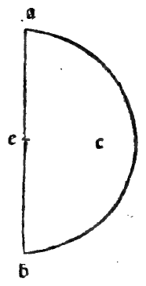

:layout: book
:canonical_id: Cap. LVI
:folio: 0049–0050 (f. 17r–f. 17v)

.. _compendio-cap_56-de:

CAPITEL LVI
===========

.. rubric:: Vom sphärischen Körper und seiner Bildung.

.. folio:: 0049–0050 (f. 17r–f. 17v)
   :initial: 0049.c1.png

XL.

Von Vielen ist die Kugel definirt worden, was sie sei; besonders vom :person:`Dionysius <dionysius>`, einem würdigen Mathematiker, Auch unser Autor beschreibt sie mit grösster Kürze in seinem elften und jene Beschreibung wird von allen Späteren herbeigezogen, wo er folgendermassen sagt: Kugel ist der Körper, der die Spur des ßogens der Peripherie des Halbkreises in jeder Drehung enthält und man nehme auf irgend welche Art den Halbkreis, indem man die Linie des Durchmessers festhält, drehe sich genannter Bogen so weit herum, bis er zu der Stelle zurückkehrt, von der er sich zu bewegen begann, d. h. nachdem man den Halbkreis über irgend einer beliebigen Linie gemacht, so führe man, indem man letztere festhält, besagten Halbkreis ringsherum mit seiner ganzen Umdrehung: der so beschriebene Körper wird Kugel genannt.

Sein Centrum ist das des genannten so herumgeführten Halbkreises. Es sei z. B. der über der Linie a b beschriebene Halbkreis e, indem der Punkt e zum Centrum gemacht, und ihr ganzer Bogen sei der Theil der Peripherie a db.

Ich behaupte, dass, wenn man die Linie a b festhält, welche Durchmesser genannten Halbkreises ist, und jenen Über ihr herumführt, indem man vom Punkte d beginnt, mit seinem" Bogen nach der untern Seite zu gehen und nach dem obern hin zu dem genannten Punkte d zurückzukehren, i) von wo er sich zuerst bewegt; oder auch, wenn man entgegengesetzt nach der obern hingeht' und dann auch nach der obern mit dem genannten Bogen zum Punkte d zurückkehrt, jene vom besagten Halbkreise bei seiner Umdrehung beschrieben, Rundung besagter sphärischer Körper und Kugel ist, indem man sich vorstellt, wie es sein muss, dass besagter Halbkreis beispielsweise ein halber materieller Teller sei, weil er auf andere Weise keinen Körper bilden würde, weil der Bogen allein bei seiner Herumführung keine Spur hinterlässt, da er eine Linie ohne Ausdehnung und Tiefe.

Und das sei zu seiner Kenntniss und über seinen Ursprung gesagt.

Marginal Woodcut Diagrams (Paganini 1509)
-----------------------------------------

   Folio 0049 Diagram 2
