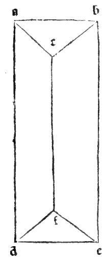

:layout: book
:canonical_id: Cap. LVIII
:folio: 0051–0052 (f. 18r–f. 18v)

.. _compendio-cap_58:
.. _compendio-cap_58-en:

CHAPTER LVIII
=============

.. rubric:: On Oblong Bodies, That Is, Bodies Longer or Higher Than They Are Wide: And First on the Round Column (Cylinder, Plates XLIII–XLIV).

.. folio:: 0051–0052 (f. 18r–f. 18v)
   :initial: 0051.c1.png

It now follows in order, most lofty Duke, for the complete understanding of this treatise, to say something concerning **oblong bodies** (*corpi oblonghi*)—that is, bodies that are longer or higher than they are wide, such as **columns** (*colonne*, cylinders and prisms) and their **pyramids** (*pyramidi*, cones and pyramids), of which many species are found. First we shall treat of columns and their origin, and then of their pyramids.

Columns are of **two kinds**: **round** (*rotonde*, cylinders) and **lateral/faceted** (*laterate*, prisms), just as plane figures are divided into **curvilinear** (bounded by curved lines) and **rectilinear** (bounded by straight lines).

.. enunciation:: Definition and Generation of the Round Column (Cylinder, :just:`XI.Def.21`)

   The round column (*colonna rotonda*, cylinder) is a solid body contained between two equal and parallel circular bases, described by the revolution of a right-angled :term:`parallelogram <paralellogramo>` when one of its sides containing the right angle remains fixed as the axis and the :term:`parallelogram <paralellogramo>` is turned completely around until it returns to the place from which it began to move (:just:`XI.Def.21`). And the round column, the sphere, and the circle that have the same diameter all share one and the same center.

.. rubric:: Proof that the Cylinder, Sphere, and Circle Share the Same Center (:just:`XI.Def.21`, :just:`I.15`, :just:`I.26`, :just:`III.31`)

.. assertion::

   1. Let :math:`abcd` be a right-angled :term:`parallelogram <paralellogramo>` (rectangle), and hold its vertical side :math:`ab` fixed while revolving the rectangle :math:`abcd` completely around :math:`ab` until it returns to its starting position (see the marginal diagram ``0052.g1.png`` on Folio 0052, and :ref:`Plates XLIII–XLIV <plates-polyhedra-en>`).
   2. The solid figure traced out by the revolution of :math:`abcd` is the **round column** (cylinder). Its fixed side :math:`ab` is the **axis** (*l'axe*) of the column; the horizontal sides :math:`bc` and :math:`ad` sweep out the two parallel **circular bases** with centers :math:`b` and :math:`a`; and the outer side :math:`cd` sweeps out the curved cylindrical surface.
   3. Now consider the rectangle :math:`abcd` at the moment when its revolution brings it to the opposite side :math:`abef` in the same plane, so that the two halves together form a single axial cross-section rectangle :math:`dcef`.
   4. Draw the diagonal :math:`de` across the axial rectangle :math:`dcef`, cutting the axis :math:`ab` at point :math:`g`. We say that :math:`de` is the **diameter of the column**, and that :math:`g` is the **common center** of the column, of the circle described on diameter :math:`de`, and of the sphere circumscribing the column!
   5. **Proof**:

      - In the two triangles :math:`agd` and :math:`bgc` (or :math:`bge`), the vertical angles at :math:`g` are equal by the :just:`fifteenth of the first <I.15>`; the angles at :math:`a` and :math:`b` are right angles by hypothesis; and the opposite radii :math:`ad` and :math:`be` (each equal to :math:`bc`) are equal.
      - Therefore, by the :just:`twenty-sixth of the first <I.26>`, the axis is bisected at :math:`g` (:math:`ag = gb`), and the diameter :math:`de` is also bisected at :math:`g` (:math:`dg = ge`).
      - Moreover, since the corner angles at :math:`c, d, e, f` of the rectangle :math:`dcef` are right angles, by the converse of the :just:`thirty-first of the third <III.31>` (:cite:`*la trigesima del terzo* <euclid:elements:III.30>` in :person:`Campanus <campanus>`), a circle described with center :math:`g` and radius :math:`gd = ge` passes through all four corners :math:`d, c, e, f`!
      - And as the rectangle revolves around the axis :math:`ab`, this circle sweeps out the **circumscribing sphere** of diameter :math:`de` centered at :math:`g`.

Therefore, a circle can be circumscribed around every right-angled :term:`parallelogram <paralellogramo>`, and a **sphere can be circumscribed around every right round column**, all sharing the same center :math:`g`!

.. qed::

Marginal Woodcut Diagrams (Paganini 1509)
-----------------------------------------

   Folio 0052 Diagram 1
