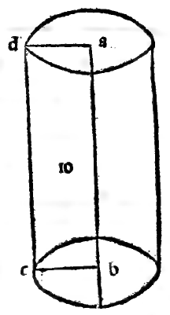

:layout: book
:canonical_id: Cap. LXI
:folio: 0053 (f. 19r)

.. _compendio-cap_61:
.. _compendio-cap_61-en:

CHAPTER LXI
===========

.. rubric:: On Five-Sided (Pentagonal) Lateral Columns and How the Species of Lateral Columns Proceed to Infinity (Plates XLIX–L).

.. folio:: 0053 (f. 19r)
   :initial: 0053.c1.png

In the third place among lateral columns stand the **five-sided** or **pentagonal columns** (*colonne laterate pentagone*, :ref:`Plates XLIX–L <plates-polyhedra-en>`, and marginal diagram ``0054.g6.png``):

.. rubric:: Properties of Pentagonal and General Polygonal Prisms (:just:`XIII.7`)

.. assertion::

   1. A pentagonal column is bounded laterally by **5 rectangular faces** (*ciascuna tetragona ouer quadrilatera*) and closed at the top and bottom by **2 parallel pentagonal bases** (rectilinear figures of 5 sides and 5 angles—for in every rectilinear plane figure, the number of angles equals the number of sides).
   2. Like quadrilateral columns, pentagonal columns may be either **equilateral and equiangular** or **inequilateral**, depending on their pentagonal bases.
   3. **Geometric Caution on Pentagons (:just:`XIII.7`)**: Note well that a pentagon can have all five sides equal and even **two** angles equal without being equiangular! However, as we proved in :ref:`Chapter XXI <compendio-cap_21-en>` by the :just:`seventh of the thirteenth <XIII.7>`, **every equilateral pentagon that has three angles equal (either consecutive or non-consecutive) is necessarily equiangular**.
   4. **Infinite Progression of Lateral Columns**: Just as plane polygons increase in number of sides to infinity (triangles, quadrangles, pentagons, hexagons, heptagons, octagons, and so forth), so the species of lateral columns increase **to infinity** (*in infinito*).
   5. In every lateral column, the two bases (upper and lower) must be **similar and equal polygons** of the same number of sides (it could not have a triangle for one base and a quadrangle for the other!), while all the lateral faces are **rectangles**; and each column takes its name (*denominatione*) from its bases: *triangula* (3 lateral faces), *quadrangola* (4), *pentagona* (5), *exagona* (6), *et sic de singulis*.

All of these may be seen both in the material models suspended in public and in perspective drawing at their corresponding Roman numerals (:ref:`Plates XLIX–L <plates-polyhedra-en>`).

.. qed::

Marginal Woodcut Diagrams (Paganini 1509)
-----------------------------------------

   Folio 0053 Diagram 1
