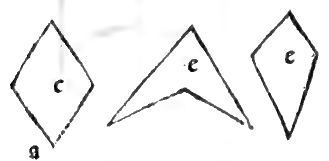
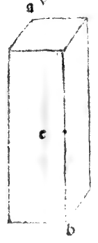
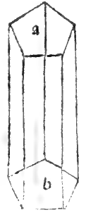

:layout: book
:canonical_id: Cap. LXIII
:folio: 0054 (f. 19v)

.. _compendio-cap_63:
.. _compendio-cap_63-en:

CHAPTER LXIII
=============

.. rubric:: On the Way to Know How to Measure All Lateral (Prismatic) Columns.

.. folio:: 0054 (f. 19v)
   :initial: 0054.c1.png

Having shown the rule for measuring round columns, we now give the general—and **exact**—rule for measuring all **lateral columns** (:term:`*colonne laterate* <colonna-laterata>`, prisms).

.. enunciation:: General Rule for the Volume of Any Lateral Column (Prism)

   In every lateral column, whatever be the number or shape of its lateral faces, first find the exact plane area (*quadratura*) of one of its polygonal bases, and multiply that base area by the perpendicular **altitude** (*altezza ouer lunghezza*) of the column. The final product is infallibly the exact solid volume (*massa corporale ouer capacita*) of the column:

   .. math::

      \text{Volume}_{\text{prism}} = \text{Area}_{\text{base}} \times h

.. assertion:: Worked Numerical Example and General Application

   1. Let :math:`ab` be a square-based lateral column (*colonna laterata tetragona*) whose altitude is :math:`10` and whose square bases measure :math:`6` on each side.
   2. First square one of the bases by multiplying a side by itself:

      .. math::

         6 \times 6 = 36

      which is the exact plane area of the square base.

   3. Multiply this base area :math:`36` by the altitude :math:`10` of the column:

      .. math::

         36 \times 10 = 360

      Thus the column contains **360 cubic braccia** (or cubic feet).

   4. And if the bases are inequilateral or irregular quadrilaterals (:term:`*elmuariffe* <elmuariffe>`), or if the column is **triangular** (3-sided), **pentagonal** (5-sided), **hexagonal** (6-sided), **heptagonal** (7-sided), *et sic de singulis*, first measure the polygonal base by the rules of triangles, pentagons, or hexagons set forth at length in our printed great work (:cite:`*Summa de Arithmetica* <pacioli:summa>`, 1494—to which access is easy for everyone, since it has been printed in copious multitude and spread throughout the world!), and multiply that base area by the altitude of the column.

.. qed::

Marginal Woodcut Diagrams (Paganini 1509)
-----------------------------------------

   Folio 0054 Diagram 5

   Folio 0054 Diagram 6

   Folio 0054 Diagram 8

   Folio 0054 Diagram 7
