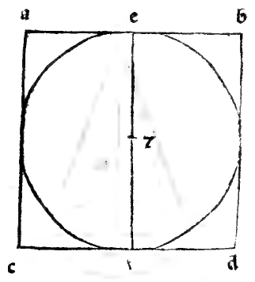
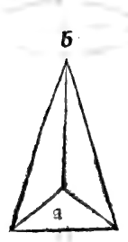
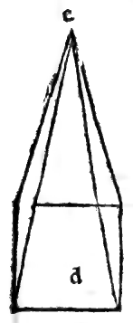
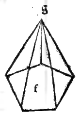

:layout: book
:canonical_id: Cap. LXV
:folio: 0055–0056 (f. 20r–f. 20v)

.. _compendio-cap_65:
.. _compendio-cap_65-en:

CHAPTER LXV
===========

.. rubric:: On Lateral (Polygonal) Pyramids and Their Varieties: Right, Oblique, and Truncated (Plates LI–LIX).

.. folio:: 0055–0056 (f. 20r–f. 20v)
   :initial: 0055.c2.png

Just as lateral columns have infinitely many species according to the polygons of their bases, so **lateral pyramids** (:term:`*pyramidi laterate* <pyramide-laterata>`, :ref:`Plates LI–LIX <plates-polyhedra-en>`) have infinitely many species derived from their corresponding lateral columns.

.. enunciation:: Definition and Derivation of Lateral Pyramids (:just:`XI.Def.12`)

   In the :just:`eleventh book <XI.Def.12>`, our philosopher defines the **lateral pyramid** as a solid figure contained by plane surfaces that rise from a single plane base to meet at a single opposite point overhead, called the **cone** or **apex** (:term:`*cono dela pyramide* <cono-pyramidale>`).

.. rubric:: Properties and Classification of Lateral Pyramids

.. assertion::

   1. **Triangular Lateral Faces**: In every lateral pyramid, all the lateral surfaces surrounding it (except the base itself) rise to meet at the single apex (*cono*) and are therefore **triangles**, whereas the base may be a triangle (as in Pyramid ``A`` with apex ``B`` in marginal diagram ``0055.g1.png``), a quadrangle (Pyramid ``D`` with apex ``E`` in ``0055.g2.png``), a pentagon (Pyramid ``F`` with apex ``G`` in ``0055.g3.png``), a hexagon, or any polygon whatever (see :ref:`Plates LI–LVI <plates-polyhedra-en>`).
   2. **Derivation from the Corresponding Column**: Every lateral pyramid is generated from its corresponding lateral column by fixing a single point in the upper base of the column and drawing straight lines from that point to all the vertices of the lower base: the resulting pyramid has as many triangular lateral faces as the base has sides, and shares the same name (*trigona/triangulare*, *quadrilatera*, *pentagona*, etc.) as its column.
   3. **Right (*Recta a Livello*) vs. Oblique/Declining (*Declinante ouer China*) Pyramids**:

      - It is not necessary that the apex point fixed in the upper plane lie directly over the exact **center** of the lower base: so long as straight lines are drawn from that apex to the corners of the base, a pyramid is formed.
      - When the apex lies directly over the center of the base (so that the axis falls at right angles to the base), it is called a **right or plumb pyramid** (*pyramide recta a livello*); when the apex leans to one side, it is called a **declining or oblique pyramid** (*declinante ouer china*).

   4. **Short or Truncated Pyramids (*Pyramidi Curte, Troncate, ouer Scapezze*)**:

      - Finally, there are pyramids that do not rise all the way to their apex (*cono*), having their top sliced off parallel to the base; these are called **short, truncated, or lopped pyramids** (*pyramidi curte, troncate, scapezze, ouer tagliate*), whether round (frustum of a cone, Figure ``A`` on Folio 0056) or lateral—such as the truncated triangular pyramid (Figure ``B``) and the truncated quadrangular pyramid (Figure ``C`` and :ref:`Plates LVII–LVIII (Piramide Tronca Solida / Vacua) <plates-polyhedra-en>`).

.. qed::

Marginal Woodcut Diagrams (Paganini 1509)
-----------------------------------------

   Folio 0055 Diagram 3

   Folio 0056 Diagram 1

   Folio 0056 Diagram 2

   Folio 0056 Diagram 3
