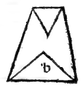
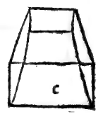
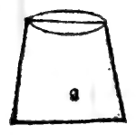
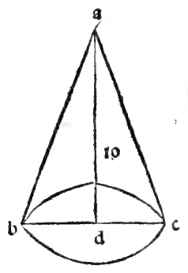

:layout: book
:canonical_id: Cap. LXVI
:folio: 0056 (f. 20v)

.. _compendio-cap_66-it:

CAPITOLO LXVI
=============

.. rubric:: Del modo e via a saper mesurare ogni pyramide.

.. folio:: 0056 (f. 20v)
   :initial: 0056.c1.png

La quantità e mesura giusta e precisa. Excclso Duca, de cadauna pyramide integra o sia tonda o latcrota se hauera dcla I) VgI. S. III. quantità dele loro colonne in questo modo. Prima trouaremo larea ouer spacio dela basa dela pyramide quale intendemo mesurare per via dele regole date disopra nel trouare la massa corporale de tutte le colonne e tonde e laterate. E quella trouata multiplicaremo nel axe cioè altezza de dicta pyramide. E quello che farà sira la capacita de tutta la sua colonna.

E de questa vltima multiplicatione sempre prenderemo el Yj cioè la sua terza parte, e quel tanto aponto fia la quantità corporale dela detta pyramide e mai falla, verbi gratia. sia la pyramide rotonda abc. dela quale la basa fia el cerchio bc. el cui :term:`dyametro <dyametro>` e 7 el suo axe ad. qual sia io. dico che prima se quadri la basa commo disopra in la colonna rotonda fo facto. peroche commo se dicto dele colonne e dele pyramidi sienno le medesime basi e le medesime altezze.

Aremo per la superficie dela basa 38 1/2 qual multiplicato per laxe ad. cioè per io. farà 385 per la capacita de tutta la sua colonna. Ora de questo dico che se prenda el Yg ne uen 12873. E questo fia la quantità de dicta pyramide. El perche e da notare per la precisione aducta che nelle rotonde a numero conuengano respondere secondo la proportione finora trouata farà i) el :term:`dyametro <dyametro>` e la circumferentia. E per quella de sopra detta fra 1 1 e 14.

Le quali commo in quel luogo se disse non sonno con precisione ma poco varia per :person:`Archimede <archimedes>` trouata. Ma non resta quello che dicto habiamo che la pyramide rotonda in quantità non sia aponto el Vg dela sua colonna rotonda. Benché aponto ancora per la ignorantia dela :term:`quadratura del cerchio <quadratura-del-cerchio>` per numero non se possa con precisione exprimere. ma el suo Yg e. E dieta colonna fia el suo triplo, cioè 3 tanto dela sua pyramide. commo se proua per la q. del 12.

Ma le altre tutte laterate per numero aponto se possano asegnare per esser le lor basi reetilinee. E cosi commo dela ') 1. fra. '-) 1. trouate. rotonda se facto el simile de tutte laterate se debia obseruare dopo che cosi de queste in la 8. del 12. se proua che le sonno triple cioè 3 tanto dela loro pyramìde. E questo a lor sufficiente dimensione sia dicto.

Marginal Woodcut Diagrams (Paganini 1509)
-----------------------------------------

   Folio 0056 Diagram 4

   Folio 0056 Diagram 5

   Folio 0056 Diagram 6

   Folio 0056 Diagram 7
