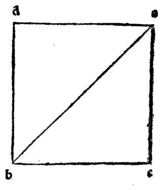
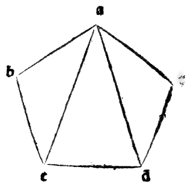

:layout: book
:canonical_id: Cap. LXVII
:folio: 0056–0057 (f. 20v–f. 21r)

.. _compendio-cap_67:
.. _compendio-cap_67-en:

CHAPTER LXVII
=============

.. rubric:: How It Is Manifestly Demonstrated That Every Lateral Pyramid Is One-Third (*Subtripla*) of Its Column, and Why Every Polygon of N Sides Resolves into N − 2 Triangles.

.. folio:: 0056–0057 (f. 20v–f. 21r)
   :initial: 0056.c2.png

To make clear to the eye why every lateral pyramid is **one-third** (*subtripla*) of its corresponding lateral column, we set forth the demonstration from the :just:`seventh of the twelfth book <XII.7>` (the sixth and eighth of the twelfth in :person:`Campanus <campanus>`) and the :just:`thirty-second of the first book <I.32>`:

.. enunciation:: Resolution of Every Prism into Triangular Prisms (*Corpi Seratili*) and Triangulation of Polygons (:just:`XII.7`, :just:`I.32`)

   1. Every three-sided column (:term:`*corpo seratile* <corpo-seratile>`) is divisible into **three equal triangular pyramids**, and is therefore **triple** (:math:`3 : 1`) each of them (:just:`XII.7`, :cite:`Campanus XII.6 <campanus:euclid:XII.6>`).
   2. Every :math:`n`-sided polygon is resolvable into :math:`n - 2` triangles by drawing diagonals from one vertex to the non-adjacent vertices (:just:`I.32` Corollary), and therefore every :math:`n`-sided lateral column is resolvable into :math:`n - 2` triangular columns (:term:`*corpi seratili* <corpo-seratile>`), each of which is triple its pyramid; hence the whole lateral column is **triple** (:math:`3 : 1`) the whole lateral pyramid!

.. rubric:: Proof and General Polygon Triangulation Rule (:just:`XII.7`, :just:`I.32`)

.. assertion::

   1. **The Triangular Column (*:term:`Corpo Seratile <corpo-seratile>`*)**: In the :just:`sixth of the twelfth <XII.7>` (Campanus numbering), our philosopher proves that a triangular prism (*:term:`corpo seratile <corpo-seratile>`*) is divided by two diagonal plane cuts into **three equal triangular pyramids** having triangular bases, so that the *:term:`corpo seratile <corpo-seratile>`* is **triple** (:math:`3 : 1`) its pyramid.
   2. **The Quadrilateral Column**: Take any four-sided column. Since its base :math:`abcd` is a quadrilateral (4 angles and 4 sides), drawing a single diagonal :math:`bd` from one corner to the opposite corner (see the marginal diagram ``0057.g1.png`` on Folio 0057) resolves the quadrilateral base :math:`abcd` into **two triangles** :math:`abd` and :math:`bcd`. Passing a vertical plane through the diagonal :math:`bd` resolves the entire quadrilateral column into **two triangular columns (*doi :term:`corpi seratili <corpo-seratile>`*)**, and resolves its quadrilateral pyramid into **two triangular pyramids**. Since each *:term:`corpo seratile <corpo-seratile>`* is triple its triangular pyramid, both *:term:`corpi seratili <corpo-seratile>`* together (the whole quadrilateral column) are **triple** both triangular pyramids together (the whole quadrilateral pyramid)!
   3. **The Pentagonal Column**: Take any five-sided column, whose base is the pentagon :math:`abcde` (see the marginal diagram ``0057.g2.png`` on Folio 0057). From a single vertex :math:`a`, draw the two pentagonal chords (*corde pentagoniche*) :math:`ac` and :math:`ad` to the two opposite vertices :math:`c` and :math:`d`. This resolves the pentagon :math:`abcde` into **three triangles** :math:`abc`, :math:`acd`, and :math:`ade`, and resolves the pentagonal column into **three triangular columns (*tre :term:`corpi seratili <corpo-seratile>`*)**, each triple its pyramid; hence all three together (the whole pentagonal column) are **triple** all three pyramids together (the whole pentagonal pyramid)!
   4. **Universal Law of Polygon Triangulation (:just:`I.32` Scholium)**:
      In general, as demonstrated upon the :just:`thirty-second of the first <I.32>`, **every polygonal figure of :math:`n` angles (and :math:`n` sides) is minimally resolved into :math:`n - 2` triangles** (*in tanti triangoli quanti sonno li suoi angoli ouer lati men doi*):

      - A **quadrilateral** (4 sides) resolves into :math:`4 - 2 =` **2 triangles**;
      - A **pentagon** (5 sides) resolves into :math:`5 - 2 =` **3 triangles**;
      - A **hexagon** (6 sides) resolves into :math:`6 - 2 =` **4 triangles**;

      *et sic in reliquis*.

.. rubric:: Praise of Euclid of Megara and Book X of the *Elements*

How deeply obligated we are, most lofty Duke, to the Ancients who by their long nightly vigils illuminated our minds—and above all to our **Euclid of Megara** (*al nostro Megarense Euclide*), who in an orderly chain gathered the discoveries of his predecessors and added his own with such diligent demonstrations throughout his sublime volume! Truly his intellect shows itself **not human, but divine** (*non humano ma divino*)—most especially in his **tenth book** (*nel suo decimo*), where he exalted human reason as high as is permitted to mortal man; nor can I comprehend how anyone could have spoken more sublimely of those most abstract **irrational lines** (*linee abstractissime irrationali*), whose science is the deepest above all others in the judgment of those who know best!

.. qed::

Marginal Woodcut Diagrams (Paganini 1509)
-----------------------------------------

   Folio 0057 Diagram 1

   Folio 0057 Diagram 2
