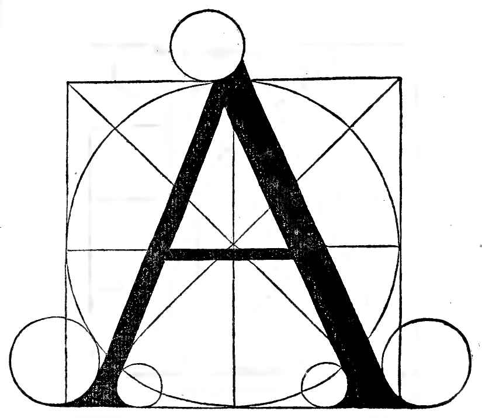

:layout: book
:canonical_id: Letter A
:folio: 0139

.. _plates-alphabet-a-de:

Buchstabe A (Folio 0139)
========================

.. rubric:: Konstruktive Proportionen des Buchstabens A

.. folio:: 0139

   Lettera A (Folio 0139)

Dieser Buchstabe A wird aus dem Kreise und seinem Quadrat entnommen. Das Bein zur Rechten muss einen der neun Theile der Höhe dick sein. Das linke Bein muss halb so dick sein als das dicke. Das mittlere (Quer-) Bein muss den dritten Theil des dicken Beines dick sein. Die Breite besagten Buchstabens bestimmt jedes Bein mittelst des Kreuzungspunktes der Diagonalen. Das mittlere liegt ein wenig tiefer, wie du hier mittelst der vorgezeichneten Durchmesser ersiehst.
