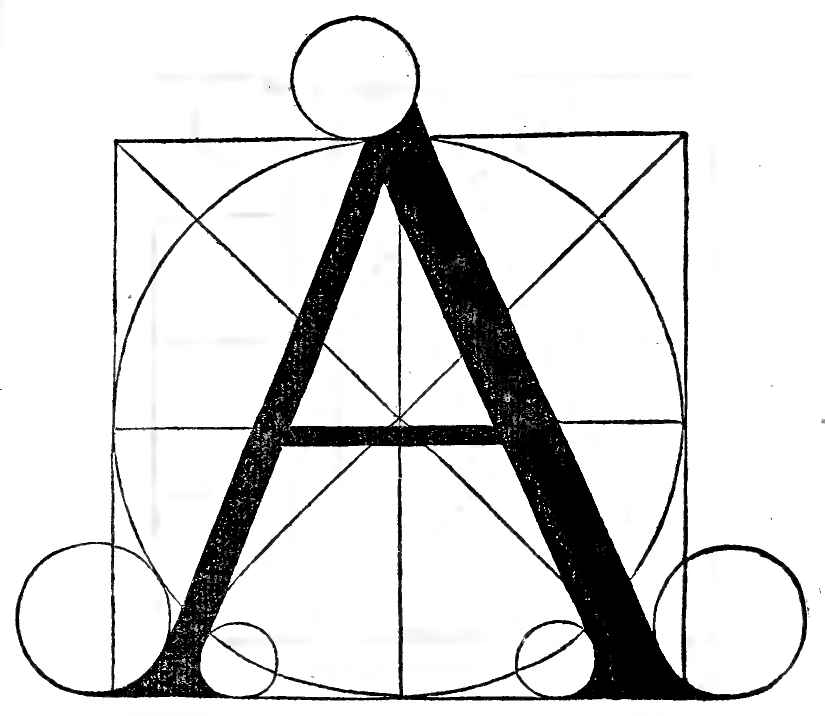

:layout: book
:canonical_id: Letter A
:folio: 0139

.. _plates-alphabet-a:
.. _plates-alphabet-a-en:

Letter A (Folio 0139)
=====================

.. rubric:: Constructive Proportions of Capital Letter A

.. folio:: 0139

   Lettera A (Folio 0139)

This letter A is drawn from the circle and its square: the right leg must be one-ninth of the height in thickness. The left leg must be half the thickness of the thick leg. The middle crossbar must be one-third the thickness of the thick leg. The width of the said letter is determined by each leg passing through the intersection of the diagonals, the middle crossbar lying slightly lower, as you see here by the marked diameters.
