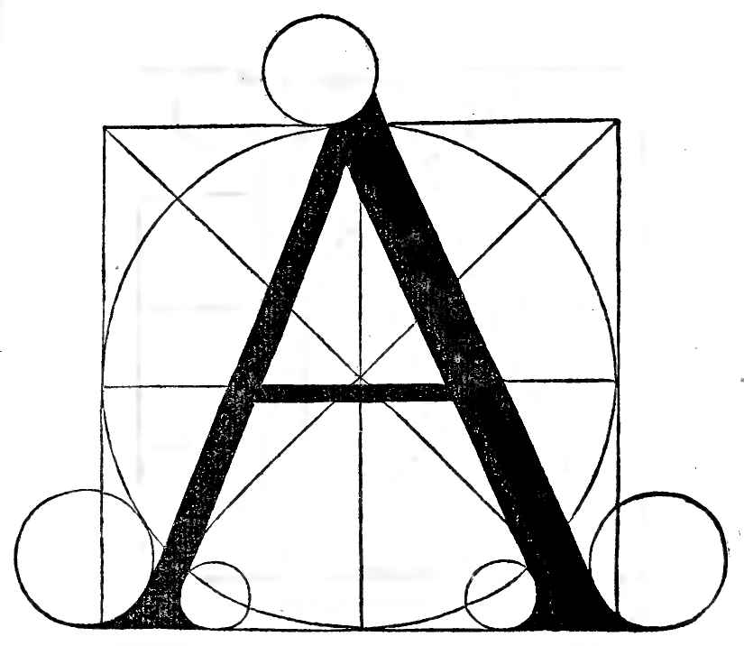

:layout: book
:canonical_id: Letter A
:folio: 0139

.. _plates-alphabet-a-it:

Lettera A (Folio 0139)
======================

.. rubric:: Proporzioni costruttive della lettera a

.. folio:: 0139

   Lettera A (Folio 0139)

Questa letera A si cava del tondo e del suo quadro: la gamba da man drita vol esser grossa dele nove parti luna de lalteza. La gamba senistra vol esser la mita de la :term:`gamba grossa <gamba-grossa>`. La gamba de mezo vol esser la terza parte de la :term:`gamba grossa <gamba-grossa>`. La largheza de dita letera cadauna gamba per mezo de la :term:`crosiera <crosiera>`, quella di mezo alquanto più bassa comme vedi qui per li diametri segnati.
