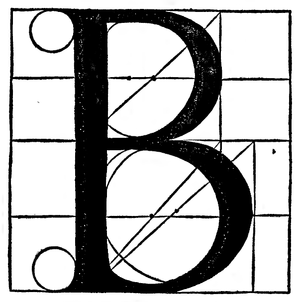

:layout: book
:canonical_id: Letter B
:folio: 0141

.. _plates-alphabet-b-de:

Buchstabe B (Folio 0141)
========================

.. rubric:: Konstruktive Proportionen des Buchstabens B

.. folio:: 0141

   Lettera B (Folio 0141)

Dieser Buchstabe B setzt sich aus zwei Kreisen zusammen und der untere ist der grössere: nämlich von den neun Theilen der Gesammthöhe muss er fünf zum Durchmesser haben, und der obere vier Neuntel, wie es sich dir hier oben im rechten Verhältniss den Augen darstellt.
