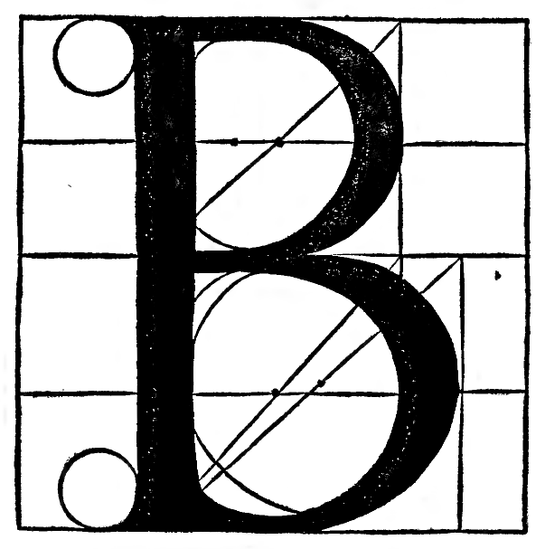

:layout: book
:canonical_id: Letter B
:folio: 0141

.. _plates-alphabet-b:
.. _plates-alphabet-b-en:

Letter B (Folio 0141)
=====================

.. rubric:: Constructive Proportions of Capital Letter B

.. folio:: 0141

   Lettera B (Folio 0141)

This letter B is composed of two circles, of which the lower is the larger by one-ninth—that is, its diameter must be five-ninths of the total height, and the upper circle four-ninths in diameter, as is proportionally presented to your eyes above.
