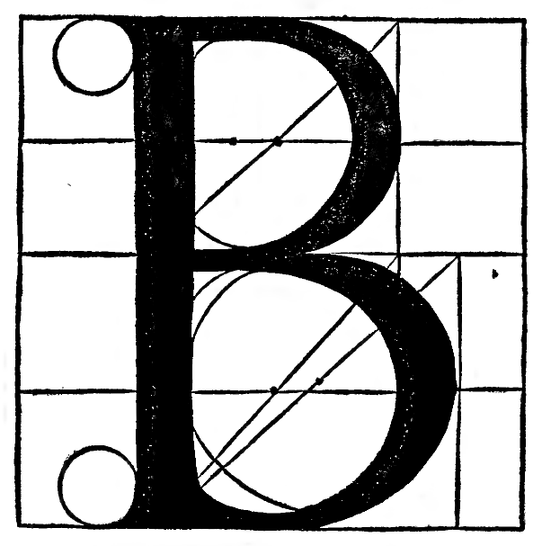

:layout: book
:canonical_id: Letter B
:folio: 0141

.. _plates-alphabet-b-it:

Lettera B (Folio 0141)
======================

.. rubric:: Proporzioni costruttive della lettera b

.. folio:: 0141

   Lettera B (Folio 0141)

Questa letera B si compone de doi tondi e quello desotto sie lo più grando de li nove parti luna cioè vol esser li cinque noni de la sua alteza per diametro. E quella desopra vol esser li quatro noni medesimamente per diametro comme qui desopra proportionatamente negliochi te sapresenta.
