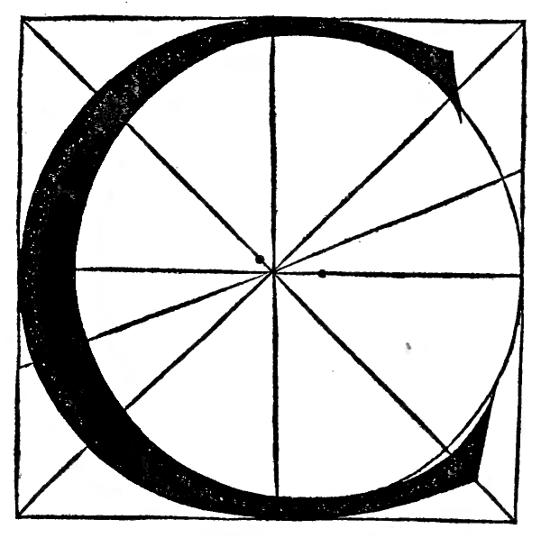

:layout: book
:canonical_id: Letter C
:folio: 0143

.. _plates-alphabet-c-de:

Buchstabe C (Folio 0143)
========================

.. rubric:: Konstruktive Proportionen des Buchstabens C

.. folio:: 0143

   Lettera C (Folio 0143)

Dieser Buchstabe C wird aus dem Kreise und seinem Quadrat entnommen, indem man den vierten Theil des Kreisbogens von aussen und innen her verdickt. Der Kopf oben endigt über dem Durchschnitt des Durchmessers und Kreisumfanges, der unten überschreitet den Kreuzungspunkt um ein halbes Neuntel nahe der Ecke des Quadrates, wie es in der Figur erhellt, und ergibt sich auf dieselbe Art wie ein O.
