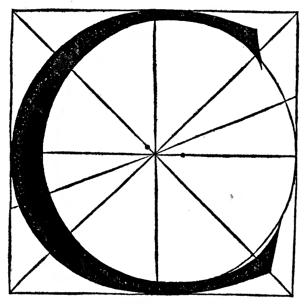

:layout: book
:canonical_id: Letter C
:folio: 0143

.. _plates-alphabet-c:
.. _plates-alphabet-c-en:

Letter C (Folio 0143)
=====================

.. rubric:: Constructive Proportions of Capital Letter C

.. folio:: 0143

   Lettera C (Folio 0143)

This letter C is drawn from the circle and its square, thickening the curve by a quarter-part on the outside and inside. The upper head terminates above the intersection of the diagonal and circumference; the lower passes beyond the intersection by half a ninth toward the corner of the square, as appears in the figure, and is hollowed out like an O.
