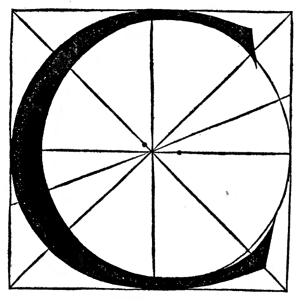

:layout: book
:canonical_id: Letter C
:folio: 0143

.. _plates-alphabet-c-it:

Lettera C (Folio 0143)
======================

.. rubric:: Proporzioni costruttive della lettera c

.. folio:: 0143

   Lettera C (Folio 0143)

Questa lettera C se cava del tondo e del suo quadro ingrossando la quarta parte de fore e ancora de dentro. La testa desopra fenisci sopra la croci del diametro e :term:`circonferentia <circonferentia>`. Quella desotto passando la croci mezo nono apresso la costa del quadrato comme apare in la figura e cavasi comme uno O.
