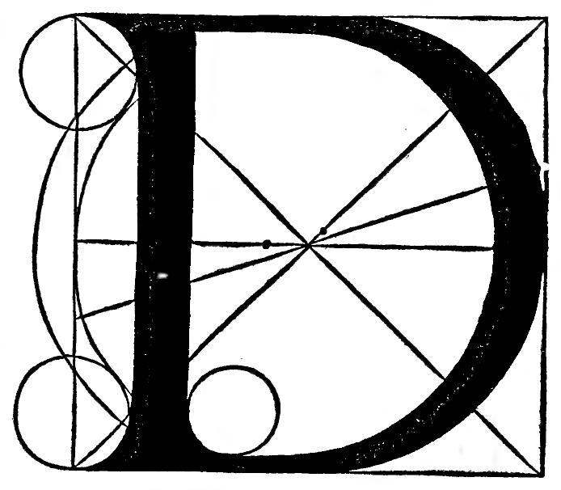

:layout: book
:canonical_id: Letter D
:folio: 0145

.. _plates-alphabet-d-de:

Buchstabe D (Folio 0145)
========================

.. rubric:: Konstruktive Proportionen des Buchstabens D

.. folio:: 0145

   Lettera D (Folio 0145)

Dieser Buchstabe D wird aus dem Kreise und Quadrate entnommen. Das geradlinige Bein muss zwischen den Kreuzpunkten von Kreis und Diagonalen einen der neun Theile dick sein. Der runde Körper verdickt sich wie bei anderen Krümmungen. Das Verbindungsglied oben muss ein Drittel des dicken Beines dick sein, und das unten ein Viertel oder ein Drittel.
