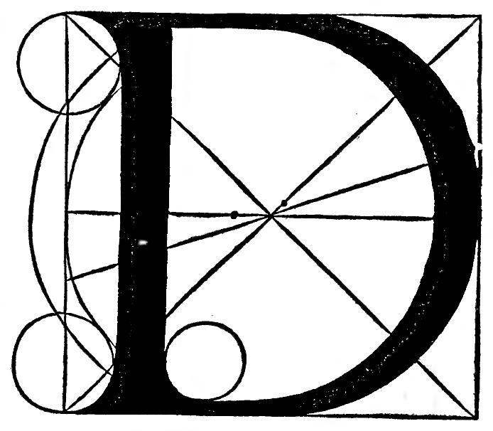

:layout: book
:canonical_id: Letter D
:folio: 0145

.. _plates-alphabet-d:
.. _plates-alphabet-d-en:

Letter D (Folio 0145)
=====================

.. rubric:: Constructive Proportions of Capital Letter D

.. folio:: 0145

   Lettera D (Folio 0145)

This letter D is drawn from the circle and the square. The straight vertical leg lies between the diagonal intersections with a thickness of one-ninth; the curved body thickens like the other circular letters. The upper join is one-third the thickness of the thick leg, and the lower one-quarter or one-third.
