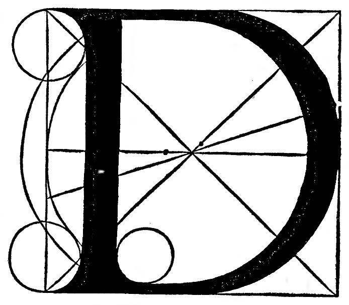

:layout: book
:canonical_id: Letter D
:folio: 0145

.. _plates-alphabet-d-it:

Lettera D (Folio 0145)
======================

.. rubric:: Proporzioni costruttive della lettera d

.. folio:: 0145

   Lettera D (Folio 0145)

Questa letera D se cava del tondo e del quadro. La gamba derita vol esser de dentro le crosere grossa de nove parti luna; el corpo se ingrossa commo deli altri tondi. La apicatura desopra vol esser grossa el terzo de la :term:`gamba grossa <gamba-grossa>` et quella desotto el quarto over terzo.
