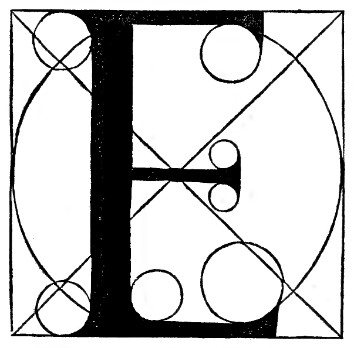

:layout: book
:canonical_id: Letter E
:folio: 0147

.. _plates-alphabet-e-de:

Buchstabe E (Folio 0147)
========================

.. rubric:: Konstruktive Proportionen des Buchstabens E

.. folio:: 0147

   Lettera E (Folio 0147)

Dieser Buchstabe E leitet sich aus dem Kreise und seinem Vierseit her. Das dicke Bein muss einen der neun Theile, das obere die Hälfte des dicken Beines stark sein, das untere gleicherweise; das mittlere den dritten Theil des dicken Beines, wie das mittlere des A, und besagter Buchstabe muss so breit sein wie die halbe Seite seines Vierecks, und so wird er am vollkommensten sein.
