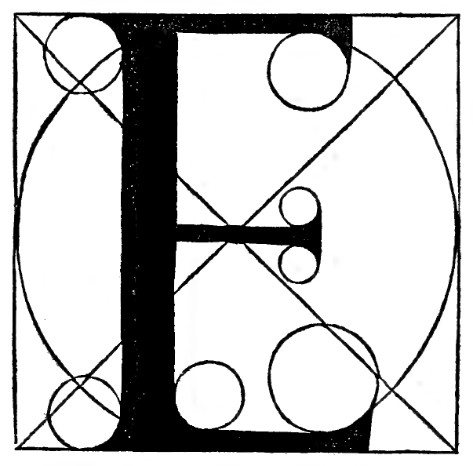

:layout: book
:canonical_id: Letter E
:folio: 0147

.. _plates-alphabet-e:
.. _plates-alphabet-e-en:

Letter E (Folio 0147)
=====================

.. rubric:: Constructive Proportions of Capital Letter E

.. folio:: 0147

   Lettera E (Folio 0147)

This letter E is drawn from the circle and its square. The thick vertical stem is one-ninth of the height. The upper horizontal arm is half the thickness of the thick stem, and the lower arm likewise; the middle arm is one-third the thickness of the thick stem, like the crossbar of the A; and the said letter is half its square in width, and thus will be most perfect.
